# QAIRU validator: проверка требований с доказательствами

[](https://github.com/noncalan/QAIRU-larpers-/actions/workflows/ci.yml)

**CLI-агент читает документ требований (PDF, DOCX или Markdown), режет его на отдельные требования, проверяет каждое и весь набор по ISO/IEC/IEEE 29148:2018 (п. 5.2.5, 5.2.6) и IEEE 830-1998 (п. 4.3) и пишет отчёт на русском: что нарушено, где именно в документе, что исправить первым и какие вопросы задать автору.**

Главный принцип: **модель предлагает, код проверяет.** Каждая цитата в отчёте сверена кодом с исходным документом, важность и все счётчики считает код, а любой сбой (битый файл, нет модели, лимит) превращается в понятную диагностику в отчёте, а не в падение.

Команда **QAIRU larpers**, отбор **BCC-HUB x MNU AI Agent Challenge 2026**, кейс [AI Requirements Validator](https://github.com/BCC-HUB/ai-requirements-validator-task) (копия ТЗ: [`docs/case/task.md`](docs/case/task.md)).

<!-- Запись терминала 30–60 с (docs/img/demo.gif или .svg) добавит задача «Демо» (#55). -->

## Для жюри: где что

| Что | Где |
|---|---|
| Запустить агента за 5 минут (в том числе без ключа и без подписки) | [Быстрый старт](#быстрый-старт) |
| Отчёт на сдачу, который сделал этот агент по `requirements.pdf` | Кандидат RC1 от 26.11: [`reports/v0.9-rc1/report.pdf`](reports/v0.9-rc1/report.pdf) (там же Markdown, запись прогона и [согласие форматов](reports/v0.9-rc1/formats.md)). Финальный отчёт кладёт релиз v1.0, 27.11 |
| Как устроен агент | [Как это работает](#как-это-работает), подробно [`docs/architecture.md`](docs/architecture.md), решения [`docs/adr/`](docs/adr/README.md) |
| Насколько он точен и чем лучше одного запроса в чат | [Качество агента](#качество-агента), сырые цифры [`evals/results/`](evals/results/summary.md) |
| Битые файлы, сканы, сбои модели | [Устойчивость](#устойчивость), 20 готовых отчётов в [`reports/robustness/`](reports/robustness/README.md) |
| Вопросы автору ТЗ и повторная проверка с ответами | [Уточнение у автора](#уточнение-у-автора) |
| Как мы не подгоняли агента под проверяемый документ | [`docs/no-overfitting.md`](docs/no-overfitting.md) |
| Честные ограничения | [Ограничения](#ограничения) |
| Исследования и журнал решений | [`docs/research/`](docs/research/README.md), [`docs/decisions.md`](docs/decisions.md) |

---

## Быстрый старт

### 1. Установить

Нужны **git** и **[uv](https://docs.astral.sh/uv/)**: uv сам скачает Python 3.11+ и все библиотеки.

```bash
# uv: macOS и Linux
curl -LsSf https://astral.sh/uv/install.sh | sh
# uv: Windows (PowerShell)
powershell -ExecutionPolicy ByPass -c "irm https://astral.sh/uv/install.ps1 | iex"
```

Перезапустите терминал, затем:

```bash
git clone https://github.com/noncalan/QAIRU-larpers-.git
cd QAIRU-larpers-
uv sync
```

Команды ниже одинаковы в bash и PowerShell.

### 2. Выбрать путь запуска

Агенту нужна модель Claude. ТЗ просит, чтобы платный ключ не был обязателен, но бесплатного доступа к Claude нет, поэтому путей три:

| Путь | Что нужно | Цена | Когда выбрать |
|---|---|---|---|
| **А. Без модели (replay)** | ничего | бесплатно, секунды | Посмотреть, как агент работает, и пересобрать наш отчёт из записи вызовов модели |
| **Б. Подписка Claude** | [Claude Code](https://code.claude.com/docs/en/setup) с входом в Pro или Max | деньги не списываются, тратится лимит подписки | Проверить свой документ. Так работает команда |
| **В. Ключ Claude API** | ключ с положительным балансом | около $3 за прогон по умолчанию (оценка ниже) | Проверить свой документ без Claude Code |

#### Путь А. Без ключа и без подписки

В репозитории лежат записи живых прогонов на трёх форматах документа: каждый вызов модели и ответ целиком. Агент проходит весь конвейер заново, а ответы модели берёт из записи:

```bash
uv run validator data/input/requirements.pdf out/report.pdf --backend replay --replay tests/fixtures/e2e/pdf/run
```

Итог печатается в терминал, отчёт ложится в `out/report.pdf` и `out/report.md` (что ещё рядом, см. [Что получится](#что-получится)). Для Markdown и DOCX: `data/input/requirements.md` с `tests/fixtures/e2e/md/run`, `data/input/requirements.docx` с `tests/fixtures/e2e/docx/run`.

Записи сделаны 26.11 профилем по умолчанию (1 проход поиска). Отчёт кандидата RC1 пересобирается так же: `--replay reports/v0.9-rc1/run`. После релиза v1.0 появится запись финального прогона в `reports/run/`, и наш отчёт на сдачу пересобирается так же.

Битые файлы проверяются вообще без модели, например `uv run validator tests/fixtures/broken/password.pdf out/broken/report.md` (все 20 случаев: [`tests/fixtures/broken/`](tests/fixtures/broken/README.md)).

#### Путь Б. Подписка Claude (основной)

1. Установите Claude Code ([инструкция](https://code.claude.com/docs/en/setup)): macOS и Linux `curl -fsSL https://claude.ai/install.sh | bash`, Windows PowerShell `irm https://claude.ai/install.ps1 | iex` (на Windows нужен ещё [Git for Windows](https://git-scm.com/download/win)).
2. Войдите в аккаунт с подпиской Pro или Max: запустите `claude`, выполните `/login`, выйдите. Проверка: `claude auth status`.
3. Запустите проверку:

```bash
uv run validator data/input/requirements.pdf out/report.pdf
```

Агент сам найдёт `claude` и будет вызывать модель командой `claude -p` из пустой временной папки, без инструментов и без файлов репозитория в контексте. Ключ API не нужен. Прогон идёт около 8–10 минут, прогресс по шагам пишется в `out/report.log`.

#### Путь В. Свой ключ Claude API

1. Получите ключ: [platform.claude.com](https://platform.claude.com/) → **API keys** → **Create key**. На счёте нужен положительный баланс.
2. Положите ключ в файл `.env` в корне репозитория (он в `.gitignore` и в git не попадёт):

```bash
cp .env.example .env        # Windows: copy .env.example .env
# откройте .env и впишите ключ в строку ANTHROPIC_API_KEY=
```

3. Запустите проверку:

```bash
uv run validator data/input/requirements.pdf out/report.pdf --backend api
```

- Ключ читается только из окружения или `.env` и никуда не печатается: ни в отчёт, ни в лог вызовов. Без ключа агент пишет отчёт с диагностикой `LLM-001` и завершается с кодом 5.
- `--backend api` нужен явно, если у вас стоит и Claude Code с входом: по умолчанию агент выбирает подписку, потому что она не списывает деньги.
- **Цена.** Замер 26.11 на `requirements.md`: прогон по умолчанию стоил **$1,50 и 476 с** по тарифу API ([`evals/results/2026-11-26-checkpoint-b.md`](evals/results/2026-11-26-checkpoint-b.md)), но это до двух шагов, добавленных позже: в записи живого прогона пример-свидетель стоил $0,42, попытка теста $1,07 ([`tests/fixtures/e2e/md/run/calls.jsonl`](tests/fixtures/e2e/md/run/calls.jsonl)). Отсюда оценка **около $3 за прогон** с одним проходом. `--profile submit` (проход на `xhigh`) и `--passes 3` дороже. Точная цена каждого прогона пишется в паспорт отчёта, а `--max-budget-usd 5` остановит новые вызовы, когда потрачено $5.
- **Честно:** у команды нет оплаченного ключа (решение D-009 в [`docs/decisions.md`](docs/decisions.md)), поэтому этот путь вживую не запускали. Он использует те же промпты и схемы, что и подписка, и проверен тестами на записанных ответах API ([`tests/test_llm_api.py`](tests/test_llm_api.py)).

### Что получится

Путь к отчёту задаёте вы вторым аргументом: `.md` или `.pdf`. Рядом агент кладёт всё остальное:

| Файл | Что в нём |
|---|---|
| `out/report.pdf` | Отчёт в PDF (если второй аргумент `.pdf`) |
| `out/report.md` | Тот же отчёт в Markdown, пишется всегда |
| `out/report.json` | Тот же отчёт для машин: из него собраны Markdown и PDF |
| `out/questions.yaml` | Вопросы автору ТЗ с вариантами ответа и пустым полем `answer` |
| `out/report.log` | Шаги прогона, время, трассировки ошибок |
| `out/run/` | `calls.jsonl` (каждый вызов модели: модель, токены, цена, статус) и `responses/` (ответы целиком): по этой папке `--backend replay` пересобирает отчёт |

В терминал агент печатает одну строку итога и завершается с [кодом возврата](#коды-возврата). Ответы модели кешируются в `.cache/validator/`: повторный прогон того же документа лимит не тратит (`--cache refresh` спросит заново).

### Пример отчёта

Начало первой страницы отчёта по `requirements.pdf`, собранного командой из «Пути А» (запись живого прогона 26.11, три прохода поиска):

```text
Итог на первой странице

🔴 Начинать разработку и тестирование нельзя: 8 критичных нарушений мешают написать тест-кейсы (F-01, F-02, F-03, F-04, F-05 и ещё 3)

Требований: 58 · нарушений: 67 · критичных: 8 · «неясно»: 6 · вопросов автору: 15

Что исправить первым
1. F-01 · критично · Полнота набора: Условие отправки push не учитывает включённость уведомления
   - Цитата: «Проведение покупки → пересчёт расходов → проверка порога → при достижении отправка push → завершение.»
     (раздел «Требования к изменениям › BPMN схема процесса», стр. 2)
   - Предложенная формулировка: Push отправляется только если для карты сохранена настройка с enabled=1; ...
   - Вопрос автору: Q-02
```

Дальше идут разделы, которых требует ТЗ (п. 6): паспорт прогона (документ и его SHA-256, дата, версия агента = коммит, модели по шагам, цена), диагностика входа, таблица нарезки требований, проверка каждого требования, проверка набора, вопросы автору, сводка и итог. В конце самопроверка: код сверяет, что все разделы на месте, у каждой находки есть сверенная цитата, а счётчики сводки сходятся со строками таблиц.

Отчёт по другому документу, ТЗ этого кейса (как проверяемый документ при настройке промптов его не использовали): [`evals/results/checklists/task/run-1/report.md`](evals/results/checklists/task/run-1/report.md).

---

## Как это работает

Модель делает то, что умеет только она: решает, где в документе требования, ищет дефекты, строит пример-свидетель, пишет черновик тест-кейса и вопросы автору. Всё, от чего зависит доверие к отчёту, делает код без модели.



| Шаг | Кто | Что |
|---|---|---|
| 0. Защищённый вход | код | Тип файла по содержимому, пустой, обрезанный, с паролем, zip-бомба, скан. При проблеме сразу отчёт-диагностика |
| 1. Разбор | код | PDF, DOCX, MD → блоки с якорями: страница, раздел, строка, ячейка таблицы. Сканы распознаёт Tesseract, если он установлен |
| 2. Нарезка | модель + код | Модель называет ID блоков-требований, код сам цитирует текст и ставит номера `R-NN` |
| 3. Линтер | код | Правила без модели: размытые слова, TBD, пустые поля, расхождения в REST |
| 4. Поиск дефектов | модель | Проход по всему документу с рубрикой 29148 и IEEE 830 и доменными чек-листами, которые включаются по словам документа |
| 5. Слияние | код | Находки проходов и линтера в одну, счётчик «найдено в N из K» |
| 6. Доказательства | модель + код | Пример-свидетель для противоречий (сценарий, в котором два места документа дают разный результат) и попытка тест-кейса с пропуском `[?]` там, где в документе нет значения. Код сверяет цитаты и расхождение |
| 7. Верификатор | код | Каждая цитата сверена с документом, находка без сверенной цитаты отбрасывается с причиной. Важность, счётчики и светофор по таблице в коде |
| 8. Вопросы автору | модель + код | Кандидатов даёт код, модель пишет карточку с вариантами ответа, второй вызов снимает вопросы, на которые документ уже отвечает (снимает код, только по найденной цитате) |
| 9. Отчёт | код | Одна модель данных → JSON, Markdown, PDF, самопроверка по ТЗ п. 6 |

Модели по шагам ([решение D-010](docs/decisions.md)): поиск Opus 5.5, нарезка и попытка теста Sonnet 5.5, перенос ответа в JSON Haiku 5.5, свидетель и вопросы Opus 5.5. Каждый вызов записан, поэтому отчёт воспроизводим без модели, а паспорт показывает версию агента, хеш промптов и фактические модели.

Подробно (контракты данных, бэкенды модели, коды сбоев, карта пакета): [`docs/architecture.md`](docs/architecture.md). Ключевые решения с альтернативами: [`docs/adr/`](docs/adr/README.md).

---

## Качество агента

Главный вопрос лида QA: чем агент лучше одного запроса в чат? Мы сравнили их на `requirements.md` по одному протоколу, три прогона каждого, все прогоны в зачёте. Полная таблица и оговорки: [`evals/results/summary.md`](evals/results/summary.md).

| Метрика | Один промпт | Агент, 1 проход (по умолчанию) | Агент, 3 прохода |
|---|---|---|---|
| Цитаты в отчёте есть в документе | 84,7 % | **100 %** | **100 %** |
| Цитаты дословно, без правок модели | 76,0 % | **100 %** | 99,4 % |
| Precision строгая / мягкая (две модели вслепую, не люди) ᵖ | 51,2 % / 97,7 % | не мерили | 33,3 % / 92,0 % |
| Жаккар мест документа между прогонами (стабильность) | 0,527 | **0,817** | 0,866 |
| Жаккар найденных дефектов эталона между прогонами | 0,924 | 0,890 | 0,909 |
| Число находок: мин–макс | 43–59 | 46–50 | 77–83 |
| Вопросы автору ТЗ на прогон | нет | 14,3 | 14,7 |
| Время прогона | 135 с | 476 с | 535 с |
| Цена по тарифу API | $0,31 | $1,50 | $2,86 |
| Критичные дефекты эталона найдены | 100 % | 100 % | 100 % |
| Recall по эталону (найдено или частично) | **93,3 %** | 88,9 % | 92,6 % |
| Recall строгий | **84,4 %** | 71,9 % | 80,0 % |

ᵖ Пилот на записи живого прогона с тремя проходами и на первом прогоне одного промпта ([`evals/results/2026-11-26-precision-pilot-e2e-md.md`](evals/results/2026-11-26-precision-pilot-e2e-md.md)). Строгая: «настоящий дефект» по согласию двух моделей, мягкая: «настоящий или спорно».

**Что это значит:**

- **Доверие к находкам.** У агента каждая цитата есть в документе и дословна, у одного промпта каждая шестая цитата в документе не находится. Агент указывает на одни и те же места документа между прогонами заметно стабильнее (0,817 против 0,527), а число находок гуляет меньше. Плюс вопросы автору, которых один промпт сам не задаёт.
- **Где агент не лучше.** Полнота по эталону у агента с одним проходом ниже (88,9 % против 93,3 %), строгая precision тоже ниже: почти весь разрыв дают незначительные замечания, а все критичные находки агента разметчики признали настоящими. Агент дороже и медленнее: $1,50 и 8 минут против $0,31 и 2 минут.
- **Почему один проход по умолчанию.** Три прохода поднимают recall до 92,6 %, но стоят вдвое дороже. Правило выбора записали в план до замеров и применили кодом ([`evals/results/2026-11-26-checkpoint.md`](evals/results/2026-11-26-checkpoint.md), D-011). Три прохода остаются флагом `--passes 3`.

**Оговорки.** Эталон из 45 дефектов и судью eval тоже делал Claude, поэтому recall это оценка, а не истина. Precision размечали две модели (Opus 5.5 и Fable 5.2) вслепую, не люди; чтобы проверить самих разметчиков, в пачки подмешали 17 заведомо ложных находок, и они поймали 15 и 16 из них. Цифры сняты на версии `dc2a3cc` до слоя доказательств; финальный замер на кандидате к релизу 27.11 заменит их здесь и в [`summary.md`](evals/results/summary.md).

**Другие замеры:**

- **Другой документ.** ТЗ кейса как проверяемый документ при настройке промптов не использовали: 24 находки, 325 с, $0,99 ([`evals/results/2026-11-26-checklists.md`](evals/results/2026-11-26-checklists.md), отчёт [`report.md`](evals/results/checklists/task/run-1/report.md)). Ручной разметки по нему пока нет.
- **Три формата.** Живые прогоны на MD, PDF и DOCX нашли по 58 требований, 100 % цитат сверены, 54 группы находок совпали во всех трёх форматах ([`evals/results/2026-11-26-formats.md`](evals/results/2026-11-26-formats.md)).
- **Доменные чек-листы** (деньги, даты, статусы, уведомления, API, персональные данные): recall на нашем документе не вырос (86,7 % против 88,9 %, в пределах разброса), шум не вырос (0 % против 1,3 %), поэтому включены по умолчанию ([`evals/results/2026-11-26-checklists.md`](evals/results/2026-11-26-checklists.md)).
- Как считаются метрики и как повторить: [`evals/README.md`](evals/README.md).

---

## Ценность

Расчёт «ревью человеком против агента плюс проверка его отчёта человеком» с ценой в тенге готовит задача #52 (`docs/value.md`, 27.11): время ручного ревью берём из опубликованных скоростей инспекции и помечаем как оценку, наших замеров на людях нет. Уже измерено: один прогон агента на 8-страничном документе идёт около 8 минут и стоит около $1,50–3 по тарифу API (см. путь В), а каждая находка приходит с цитатой и местом в документе, поэтому её проверка сводится к чтению одного абзаца.

---

## Уточнение у автора

Агент не только находит дефекты, но и задаёт автору ТЗ вопросы, без ответа на которые нельзя писать тест-кейсы: с конкретным сценарием, вариантами ответа и адресатом (бизнес, архитектор). Вопросы лежат в отчёте и в `out/questions.yaml`.

Автор вписывает в `questions.yaml` букву варианта, свой ответ или «пропустить», и агент проверяет документ снова с учётом ответов:

```bash
uv run validator data/input/requirements.md out2/report.md --answers out/questions.yaml
uv run validator data/input/requirements.md out/report.md --ask    # 3–5 главных вопросов прямо в терминале, затем сразу проверка
```

Второй прогон стоит один дополнительный вызов модели (остальное из кеша). Модель предлагает, какие находки ответ закрыл или уточнил и какие новые дефекты появились, а принимает код: «закрыто» только если находка связана с вопросом, новая находка проходит тот же верификатор цитат. В отчёте появляется раздел «Уточнения» с таблицей «до и после». Сам документ не меняется: цитаты по-прежнему сверяются только с ним.

Пример без модели на придуманных для демо ответах ([`examples/answers.yaml`](examples/answers.yaml)):

```bash
uv run validator data/input/requirements.md out2/report.md --backend replay --replay tests/fixtures/e2e/md/run --answers examples/answers.yaml
```

На записи от 26.11 (один проход поиска) этот пример даёт: нарушений 41 вместо 46, критичных 5 вместо 6 (одну новую критичную находку дали сами ответы), открытых вопросов 3 вместо 13. Светофор остаётся красным, потому что ответы закрыли не все критичные находки.

---

## Устойчивость

Жюри отдельно проверит битые файлы и документы без текста. Агент не падает ни в одном из 20 подготовленных случаев: он пишет отчёт с причиной, тем, что сделал сам, и подсказкой человеку, а код возврата говорит, что случилось. Готовые отчёты: [`reports/robustness/`](reports/robustness/README.md), пересобрать: `uv run python scripts/robustness.py` (без модели, секунды).

| Случай | Код | Диагностика | Что в отчёте |
|---|---|---|---|
| Пустой файл, PDF без страниц, картинка с расширением .pdf, двоичный мусор как .md | 4 | `IN-002`, `IN-042`, `IN-010` | «Проверка не выполнена», причина и как пересохранить файл |
| PDF или DOCX с паролем | 4 | `IN-020`, `IN-021` | Назван пароль на открытие; подобрать пароль агент не пытается |
| Обрезанный DOCX, zip-бомба (300 МБ внутри) | 4 | `IN-032`, `IN-030` | Файл не распаковывается; бомба узнаётся по заголовкам архива без распаковки |
| Мусорный текстовый слой (шрифты без Unicode) | 4 | `IN-052` | Какая доля символов нечитаема и почему по такому тексту нельзя цитировать |
| Скан без текстового слоя | 3 или 4 | `IN-050`, `IN-055` | С Tesseract агент распознаёт скан и помечает места «текст распознан (OCR)», код 3. Без Tesseract объясняет, что это скан и где взять текстовый PDF, код 4 |
| Обрезанный PDF со спасёнными страницами, скан на части страниц, пустой шаблон | 3 | `IN-043`, `IN-051`, `IN-081` | Проверка по прочитанному, непроверенные страницы названы |
| `claude` не установлен или нет входа, нет ключа | 5 | `LLM-001` | Отчёт по правилам линтера без модели и как войти |
| Лимит подписки, перегрузка, таймаут, оборванный ответ, отказ модели | 5 | `LLM-002`, `LLM-004`, `LLM-012`, `LLM-011`, `LLM-013` | То же, плюс что стало с каждым шагом: нарезка упрощена, поиск пропущен, вопросы собраны кодом |
| Команды модели в документе («игнорируй инструкции», строка `system:`) | 0 | `IN-082` | Команда не выполнена и названа находкой с цитатой, обычные дефекты найдены |
| Документ на английском или на двух языках | 0 | нет | Отчёт на русском, цитаты на языке оригинала |

Сбои модели воспроизведены подменой процесса `claude` (`scripts/robustness_sim.py`): поиск `claude`, разбор ответа, повтор, диагностика и код возврата настоящие. Эти случаи и все битые файлы проверяют тесты (`tests/test_guard.py`, `tests/test_robustness.py`) в CI на Ubuntu, Windows и macOS.

**Длинные документы.** Если документ длиннее примерно 12 тыс. токенов, агент режет его на части по разделам, проверяет части с общими номерами требований и отдельным вызовом сверяет противоречия между частями. До первого вызова он печатает оценку цены. Живой прогон на синтетическом ТЗ в 66 страниц: 16 частей, код 0, около 26 минут и $12,7 по тарифу API ([`tests/fixtures/long/`](tests/fixtures/long/README.md)).

---

## Ограничения

- **Полнота не выше одного промпта**, а строгая precision ниже (см. [Качество агента](#качество-агента)). Выигрыш агента в доверии к находкам, стабильности мест и вопросах автору, а не в числе найденного.
- **Precision и recall оценены моделями**, не людьми: эталон, судья и разметчики это Claude (Fable 5.2 как второй разметчик).
- **Один проход нестабилен по составу находок:** Жаккар находок между прогонами 0,51, у трёх проходов 0,62 ([`summary.md`](evals/results/summary.md)). Для важных документов `--passes 3`.
- **Путь через API вживую не запускали** (нет оплаченного ключа), он проверен тестами на записанных ответах.
- **Сканы** распознаются, только если установлен Tesseract с русским языком (Ubuntu `sudo apt install tesseract-ocr tesseract-ocr-rus`, macOS `brew install tesseract tesseract-lang`). Качество OCR не измеряли.
- **Длинные документы дороги:** 66 страниц стоили $12,7 и 26 минут. Ограничить расходы: `--max-budget-usd`.
- **Язык.** Отчёт всегда на русском. Английский и смешанный документы прогнаны по одному разу (`reports/robustness/english`, `mixed-language`), качество на них не мерили.
- **У подписки есть лимит** на 5-часовое окно: если он кончился посреди прогона, агент пишет отчёт с `LLM-002` и временем сброса, а повторный прогон возьмёт уже полученные ответы из кеша.
- **Сбой второстепенного шага** (линтер, свидетель, попытка теста) виден в диагностике, но не делает отчёт «частичным»: такой статус дают только сбои поиска, слияния и верификатора.

---

## Справочник

### Команда

```text
uv run validator ВХОД ВЫХОД [опции]
```

| Опция | Что делает |
|---|---|
| `--profile standard\|submit\|quick` | `standard` по умолчанию: 1 проход поиска на effort `medium`, им сделан и отчёт на сдачу. `submit`: 1 проход на `xhigh`, опция: на нашем документе полноты не добавил, а проход в 1,6 раза дороже ([D-012](docs/decisions.md)). `quick` сейчас совпадает со `standard` |
| `--passes N` | Число независимых проходов поиска (1–9). 3 стабильнее и вдвое дороже |
| `--backend auto\|cli\|api\|replay\|fake` | `auto` по умолчанию: подписка, если `claude` установлен и вошёл в аккаунт, иначе API при заданном ключе, иначе replay из `--replay`. `fake` отвечает фикстурами тестов |
| `--replay ПАПКА` | Папка `run/` прошлого прогона для replay |
| `--cache use\|refresh\|off` | Кеш ответов модели в `.cache/validator/` |
| `--answers ФАЙЛ` | Проверить снова с ответами автора из `questions.yaml` |
| `--ask` | Задать главные вопросы в терминале и сразу проверить с ответами |
| `--max-budget-usd X` | Не делать новых вызовов, когда потрачено X долларов по тарифу API (`LLM-003`) |
| `--critic` | Критик находок (шаг 6б). Выключен: по eval он не снизил шум и снимал настоящие находки |
| `--no-checklists` | Выключить доменные чек-листы |
| `--no-ocr` | Не распознавать сканы (то же `VALIDATOR_OCR=off`) |
| `--pdf-backend mupdf\|pdfium` | Движок PDF: `mupdf` (PyMuPDF, AGPL) по умолчанию, `pdfium` без копилефта |
| `--search-input blocks\|raw` | Что видит поиск: документ с ID блоков (по умолчанию) или чистый текст (для замера) |
| `--version` | Версия агента |

### Коды возврата

| Код | Значение |
|---|---|
| 0 | Проверка выполнена. Найденные дефекты код не меняют |
| 1 | Внутренняя ошибка (например, самопроверка нашла нарушение целостности отчёта) |
| 2 | Ошибка аргументов, отчёт не записать |
| 3 | Вход прочитан частично, проверка сделана по прочитанному |
| 4 | Вход не обработать: битый, пустой, защищённый файл |
| 5 | Нет доступа к модели или сбой модели |

Отчёт с паспортом и разделом «Диагностика» пишется во всех случаях, кроме кода 2. Каждая диагностика говорит, что увидели, что сделал агент и что сделать человеку. Коды: `IN-…` вход, `LLM-…` модель, `CFG-…` настройки и ответы автора, `INT-…` внутренние ошибки ([`docs/architecture.md`, «Сбои и коды возврата»](docs/architecture.md#сбои-и-коды-возврата)).

### Проверки без модели

```bash
uv run pytest                  # тесты, включая пересборку записанных прогонов и битые файлы
uv run ruff check && uv run mypy src evals
```

CI гоняет то же на Ubuntu, Windows и macOS без ключей и без вызовов модели, плюс gitleaks по всей истории.

### Лицензии

Код агента распространяется под лицензией **MIT** (файл `LICENSE` в корне). Он зависит от библиотек с открытыми лицензиями (версии в [`uv.lock`](uv.lock)): MIT (typer, pydantic, pdfplumber, python-docx, razdel, rapidfuzz, charset-normalizer, filetype, msoffcrypto-tool, PyYAML), BSD (python-dotenv, httpx2, jinja2, lxml, olefile, pypdfium2), Apache-2.0 (anthropic, typst), MPL-2.0 (pikepdf). Шрифты отчёта Liberation (SIL OFL) и запасной DejaVu Sans (лицензия Bitstream Vera, для знаков ₸ и ₽) лежат в `src/validator/report/fonts/`.

**Исключение: PyMuPDF под AGPL-3.0** (или коммерческой лицензией Artifex). Это движок PDF по умолчанию. Чтобы работать без AGPL, например внутри банка, достаточно флага `--pdf-backend pdfium` (pypdfium2, BSD и Apache-2.0): оба движка дают один и тот же текст, это сравнивают тесты. Почему так устроено: [ADR-0006](docs/adr/0006-pdf-engine-behind-interface.md).

---

## Для участников команды

Настройка компьютера, Claude Code со скиллами и агентами проекта, правила работы через ветки и PR: [`docs/setup/team.md`](docs/setup/team.md). Правила и контекст для Claude: [`CLAUDE.md`](CLAUDE.md). План до сдачи: [`docs/plan.md`](docs/plan.md).

### Карта репозитория

| Путь | Что там |
|---|---|
| `src/validator/` | Код агента: `cli.py`, `pipeline.py`, шаги конвейера, `llm/` (бэкенды модели), `prompts/`, `checklists/`, `report/` |
| `tests/` | Тесты и фикстуры: записанные живые прогоны (`fixtures/e2e/`), битые файлы (`fixtures/broken/`), длинный документ (`fixtures/long/`) |
| `data/input/` | Проверяемый документ кейса: `requirements.md` и сгенерированные из него `.pdf` и `.docx` |
| `reports/` | Отчёт на сдачу (кандидат `v0.9-rc1/`, затем релиз v1.0) и отчёты на битых файлах `robustness/` |
| `evals/` | Eval: судья, recall, precision, стабильность; результаты в `evals/results/` |
| `docs/architecture.md`, `docs/adr/` | Архитектура и решения с альтернативами |
| `docs/decisions.md` | Журнал решений команды |
| `docs/gold/` | Эталон дефектов. **Только для eval**: код агента его не читает, это проверяют тесты |
| `docs/case/`, `docs/hackathon/` | ТЗ кейса, разбор, kick-off, условия хакатона |
| `docs/research/`, `docs/ideas/`, `experiments/` | Исследование и эксперименты до кода агента |
| `examples/` | Пример ответов автора для `--answers` |
| `.claude/` | Общие настройки, агенты и скиллы Claude Code для команды |
