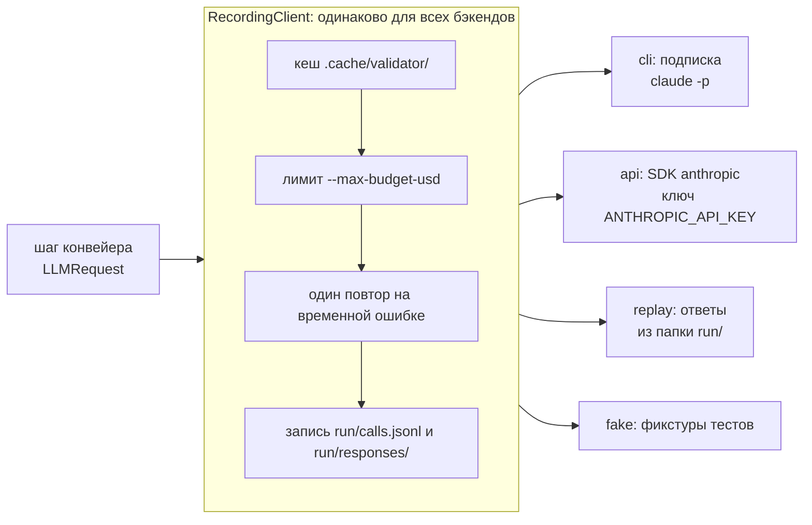

# Архитектура агента

> Описано по коду `main` на 26.11.2026 (коммит `1e792f8`). Где план ([`docs/plan.md`](plan.md)) и код расходятся, здесь описан код. Решения с цифрами: [`docs/adr/`](adr/README.md), журнал: [`docs/decisions.md`](decisions.md).

## Коротко

Агент — CLI-конвейер из десяти шагов (0–9). **Модель предлагает, код проверяет.** Модель Claude делает то, что умеет только она: решает, где в документе требования, ищет дефекты, строит пример-свидетель и черновик тест-кейса, пишет вопросы автору и сверяет находки с его ответами. Всё, от чего зависит доверие к отчёту, делает код без модели:

- каждая цитата сверена с исходным документом, текст в отчёт берётся из документа, а не из ответа модели;
- находка без сверенной цитаты в отчёт не попадает, а уходит в «отброшено» с причиной;
- важность, номера `F-NN` и `R-NN`, все счётчики сводки и светофор считает код по правилам, записанным в коде;
- модель не может сама снять находку или вопрос: снимает код, и только по цитате-основанию, которую он нашёл в документе;
- любой сбой (битый файл, нет модели, лимит подписки, упавший шаг) превращается в диагностику с кодом, и отчёт пишется всегда.

На прогон по умолчанию уходят вызовы: нарезка, один проход поиска, свидетель, попытка теста (пачки по 13 находок, на нашем документе 4 вызова), редактор вопросов и критик вопросов; на `requirements.md` около 9 вызовов, плюс повторы после временных сбоев. Длинный документ добавляет нарезку и поиск на каждую часть и сверку между частями, ответы автора (`--answers`) ещё один вызов. Шаги 6 и 8 код не вызывает, если для них нет находок или кандидатов. Каждый вызов записан, поэтому отчёт пересобирается без модели и без ключа (replay).

## Схема конвейера



Оранжевое делает модель, зелёное — код, который проверяет её ответ, синее — код без модели. Пунктир: шаг идёт только по флагу или условию (критик находок с `--critic`, сверка между частями у длинного документа, уточнения с `--answers` или `--ask`). Исходник схемы: [`img/pipeline.mmd`](img/pipeline.mmd), PNG для слайдов: [`img/pipeline.png`](img/pipeline.png), как пересобрать: [`img/README.md`](img/README.md).

```mermaid
flowchart TD
    doc[/"Документ требований<br/>PDF · DOCX · Markdown"/]:::io

    s0["<b>0 · Защищённый вход</b><br/>тип по содержимому, пароль, zip-бомба,<br/>пустой и обрезанный файл"]:::code
    s1["<b>1 · Разбор в блоки с якорями</b><br/>страница, строка, ячейка таблицы<br/>ID блоков B001, предложений B001.2"]:::code

    s1p["<b>1½ · Части длинного документа</b><br/>если длиннее 12 тыс. токенов: части по разделам,<br/>оценка вызовов и цены до первого вызова"]:::code

    s2m["<b>2 · Нарезка</b><br/>модель называет ID блоков требований<br/>Sonnet 5.5 · medium · JSON по схеме"]:::model
    s2c["код цитирует текст, ставит R-NN,<br/>проверяет ID, полноту и пересечения"]:::check
    s3["<b>3 · Линтер L-01…L-10</b><br/>правила без модели"]:::code

    s4m["<b>4 · Поиск дефектов, N проходов</b><br/>свободный текст, полная рубрика<br/>Opus 5.5 · medium (submit: xhigh)<br/>по умолчанию N = 1 (D-011)<br/>+ доменные чек-листы, если сработали триггеры"]:::model
    s4c["код разбирает ответ прохода,<br/>сверяет ID блоков"]:::check
    s4b["<b>4б · Перенос в JSON</b><br/>только то, что код не разобрал<br/>Haiku 5.5 · medium"]:::model

    s4x["<b>4в · Сверка между частями</b><br/>только для длинного документа<br/>модель называет пары R-NN, цитаты берёт код<br/>Opus 5.5 · medium (submit: xhigh)"]:::optional

    s5["<b>5 · Слияние</b><br/>место + цитаты + свойство<br/>«найдено в N из K»"]:::code

    s6a["<b>6а · Пример-свидетель</b><br/>сценарий и прочтение каждого места<br/>Opus 5.5 · high"]:::model
    s6t["<b>6в · Попытка теста</b><br/>черновик тест-кейса с пропусками [?]<br/>Sonnet 5.5 · high, пачки по 13 находок"]:::model
    s6b["<b>6б · Критик находок</b><br/>только с флагом --critic<br/>Opus 5.5 · high"]:::optional
    s6c["код сверяет цитаты свидетеля и различие ожиданий;<br/>значение теста без цитаты становится пропуском [?];<br/>снять или понизить находку может только код"]:::check

    s7["<b>7 · Верификатор</b><br/>каждая цитата сверена с документом,<br/>привязка к R-NN, важность по таблице,<br/>счётчики, светофор"]:::check

    s8a["<b>8а · Кандидаты в вопросы</b><br/>из признаков находок"]:::code
    s8m["<b>8б · Редактор вопросов</b><br/><b>8г · Критик-самоответ</b><br/>Opus 5.5 · high"]:::model
    s8c["код сверяет цитаты, считает приоритет,<br/>снимает вопрос только по цитате-ответу"]:::check

    s8e["<b>8е · Уточнения</b><br/>только с --answers или --ask<br/>модель сверяет находки с ответами автора<br/>Opus 5.5 · high"]:::optional
    s8ec["код подтверждает связь находки с вопросом,<br/>новые находки проходят верификатор,<br/>пересчёт сводки и светофора"]:::check
    s8l["пропуски [?] черновиков теста<br/>связаны с вопросами Q-NN"]:::code

    s9["<b>9 · Отчёт</b><br/>одна модель Report → JSON, Markdown, PDF<br/>самопроверка по ТЗ п. 6"]:::code
    out[/"report.md · report.pdf · report.json<br/>questions.yaml · run/ для replay"/]:::io

    doc --> s0 --> s1
    s0 -. "файл не читается:<br/>сразу отчёт-диагностика, код 4" .-> s9
    s1 --> s1p
    s1p --> s2m --> s2c --> s3
    s1p --> s4m --> s4c
    s4c -. "не разобрано" .-> s4b
    s4b --> s5
    s4c --> s5
    s3 --> s5
    s2c -. "части > 1" .-> s4x
    s4x -.-> s5
    s5 --> s6a
    s5 --> s6t
    s5 -.-> s6b
    s6a --> s6c
    s6t --> s6c
    s6b -.-> s6c
    s6c --> s7
    s2c -- "R-NN" --> s7
    s7 --> s8a --> s8m --> s8c --> s8l --> s9
    s8c -. "есть ответы автора" .-> s8e
    s8e -.-> s8ec --> s8l
    s9 --> out

    classDef model fill:#fde7d2,stroke:#c46a12,color:#3d2200,stroke-width:1.5px
    classDef check fill:#dcf2e1,stroke:#2e7d4a,color:#0f3a1d,stroke-width:1.5px
    classDef code fill:#dde9f8,stroke:#2f62a8,color:#0d2545,stroke-width:1.5px
    classDef optional fill:#fde7d2,stroke:#c46a12,color:#3d2200,stroke-width:1.5px,stroke-dasharray:6 4
    classDef io fill:#ffffff,stroke:#555555,color:#222222
```

<details>
<summary>Та же схема в mermaid (рендерится на GitHub)</summary>



</details>

Поиск видит только документ (или его часть) и не зависит от нарезки, поэтому на схеме они идут из шага 1½ параллельно. В коде (`pipeline._execute`) шаги вызываются по очереди: 2, 3, 4. Параллельно идут только проходы поиска между собой, до трёх одновременно (`search.MAX_PARALLEL_PASSES`).

## Шаги

Модели и effort берутся из `STEP_MODELS` в [`config.py`](../src/validator/config.py) (решение D-010), полными именами (`claude-opus-5-5`, а не алиас `opus`), effort всегда явно. Профиль (`--profile`) меняет только effort проходов поиска и сверки между частями.

| Шаг | Модуль | Вход → выход | Модель и вызовы | Что проверяет код | Если шаг упал |
|---|---|---|---|---|---|
| 0. Защищённый вход | [`ingest/guard.py`](../src/validator/ingest/guard.py), `sniff.py`, `containers.py` | путь → `GuardResult` | без модели | Файл есть, не пустой, не больше 100 МБ; тип по содержимому, а не по расширению; пароль, zip-бомба (по заголовкам архива), старый `.doc`, обрезанный PDF со спасением страниц | Отчёт-диагностика `IN-0xx`, код 4. Исключений не бросает |
| 1. Разбор | [`ingest/`](../src/validator/ingest/__init__.py): `md.py`, `docx.py`, `pdf.py`, `blocks.py`, `quality.py`, `injection.py` | файл → `ParsedDocument` (канонический текст, блоки `B001`, предложения `B001.2`, якоря) | без модели | PDF по символам с координатами, таблицы по ячейкам, колонтитулы убраны; мусорный текстовый слой, страницы без текста, «не похоже на требования»; команды модели в тексте (`IN-082`); скан распознаётся Tesseract `rus+eng`, если он установлен ([`ingest/ocr.py`](../src/validator/ingest/ocr.py), якоря с пометкой «OCR», `IN-050`) | Не читается: код 4 (скан без Tesseract: `IN-055` с инструкцией); прочитан частично или распознан: предупреждение, код 3 |
| 1½. Части длинного документа | [`parts.py`](../src/validator/parts.py), [`estimate.py`](../src/validator/estimate.py) | документ → `PartPlan` | без модели | Документ длиннее `LONG_DOC_TOKENS` (12 тыс. токенов) режется по разделам верхнего уровня на части около 8 тыс. токенов, раздел терминов идёт в каждую часть; нарезка и поиск вызываются на каждую часть, ID блоков и `R-NN` общие; до первого вызова оценка вызовов и цены (`LLM-070`), выше `--max-budget-usd` предупреждение (`LLM-071`); шагам 6 и 8 код показывает только разделы их находок, таймаут растёт с размером входа | План не построился: документ целиком |
| 2. Нарезка | [`segment/`](../src/validator/segment/__init__.py) | документ с ID → `Segmentation` (`R-NN`, `R-NN.k`, исключённые блоки с причиной) | Sonnet 5.5 `medium`, JSON по схеме, 1 вызов (+1 повтор) | Модель называет только ID блоков и предложений, цитату и якорь строит код; несуществующие ID, блоки без решения, пересечения → диагностика `LLM-021…023` | Запасная нарезка без модели: каждый содержательный блок от 3 слов — требование, `LLM-020` |
| 3. Линтер | [`lint/`](../src/validator/lint/__init__.py) | документ + нарезка → `CandidateFinding` | без модели | 10 правил L-01…L-10: размытые слова, лазейки, открытые перечни, «и/или», TBD, числа без единиц, битые ссылки, повторы и пропуски ID, составные обязательства. Только внутри требований | Шаг пропущен, `INT-002` |
| 4. Поиск | [`search.py`](../src/validator/search.py), `search_parse.py`, `search_values.py` | документ с ID → `PassResult` на проход | Opus 5.5 `medium` (`submit`: `xhigh`), свободный текст без схемы, N вызовов (по умолчанию N = 1) | Ответ в строгом текстовом формате разбирает код; ID блоков, которых нет в документе, отбрасываются (`LLM-034`); цитаты здесь не сверяются, это шаг 7. Доменные чек-листы (#35, [`checklists/`](../src/validator/checklists/README.md)): если слова области есть хотя бы в 2 блоках, пункты чек-листа идут в промпт отдельным разделом, строка «Чек-лист: <ID>» попадает в источник находки | Упал проход: «K−1 из K», `LLM-030`. Упали все: отчёт по линтеру, `LLM-031`, код 5 |
| 4б. Перенос в JSON | [`search_transfer.py`](../src/validator/search_transfer.py) | неразобранные находки → черновики | Haiku 5.5 `medium`, JSON по схеме, 0 вызовов, если код разобрал всё | Каждая запись проверяется по схеме и встаёт на место своего фрагмента | Повтор, затем потерянные находки названы в `LLM-033` |
| 4в. Сверка между частями | [`set_check.py`](../src/validator/set_check.py) | сжатый список требований всех частей → `CandidateFinding` | Opus 5.5 `medium`, рассуждение, затем JSON, 1 вызов, только если требования есть хотя бы в двух частях | Модель называет только `R-NN`, цитаты и места берёт код из требований; противоречие → `SET-CONS`, повтор → `SET-MOD`; пара из одной части или неизвестный ID отбрасываются (`LLM-073`) | Находки частей остаются, `LLM-072` |
| 5. Слияние | [`merge.py`](../src/validator/merge.py) | проходы + линтер → `MergedFinding` (`M-NNN`, «найдено в N из K») | без модели | Одна находка, если совпали место (общий блок), цитаты (перекрытие ≥ 0,6 по смещениям) и свойство; голосование проходов по свойству, типу, вердикту; ничего не отбрасывает | Внутренняя ошибка: `INT-001`, код 1, отчёт из того, что есть |
| 6а. Пример-свидетель | [`evidence_witness.py`](../src/validator/evidence_witness.py) | противоречия и находки со сценарием → `Witness` | Opus 5.5 `high`, рассуждение, затем JSON, 1 вызов на пачку | Свидетель принят, только если все цитаты найдены в документе, ожидания различаются после нормализации, у противоречия цитаты из разных мест и хотя бы одна из мест самой находки | Находки без свидетеля, `LLM-040` |
| 6б. Критик находок | [`evidence_critic.py`](../src/validator/evidence_critic.py) | рискованные находки → `CriticDecision` | Opus 5.5 `high`, 1 вызов, **только с `--critic`** | Какие находки рискованные, выбирает код; «снять» принимается только со сверенной цитатой-основанием вне цитат находки; находку всех K > 1 проходов не снимает, а понижает | Находки без решения критика, `LLM-042` |
| 6в. Попытка теста | [`evidence_testdraft.py`](../src/validator/evidence_testdraft.py), `evidence_testdraft_check.py` | находки про проверяемость, однозначность и «мешает тесту» → `TestDraft` (предусловие, шаги, ожидаемый результат, пропуски `[?N]`) | Sonnet 5.5 `high`, рассуждение, затем JSON, пачки по 13 находок, до 4 пачек параллельно | Значение «из документа» остаётся, только если его цитату нашёл `locate_quote` и значение в ней есть, иначе становится пропуском; число в ожидаемом результате без подтверждения тоже пропуск; «тест написать можно» принимается без пропусков и хотя бы с одним подтверждённым значением, тогда находка перестаёт «мешать тесту» и верификатор пересчитывает важность. У противоречия или находки со свидетелем черновик берёт одно прочтение, поэтому она по-прежнему мешает тесту (`contested`) | Пачка упала: её находки без черновика, `LLM-044`; что код поправил: `LLM-045` |
| 7. Верификатор | [`verify.py`](../src/validator/verify.py), [`severity.py`](../src/validator/severity.py) | `MergedFinding` → `Verification` (`F-NN`, отброшенные, сводка, светофор) | без модели | Цитаты: точно, затем нечётко (rapidfuzz ≥ 90), иначе «не найдено»; находка без сверенной цитаты отброшена; привязка к `R-NN` по якорям; важность по таблице «тип дефекта × мешает ли тест-кейсу» и ограничениям кода: «критично» по таблице, если подсказка модели не ниже (без подсказки решает таблица); дефект формы и находка с подсказкой модели «низко» не выше «незначительно», если находку не подтвердил код: правило линтера, которое само мешает тесту, или проверенный пример-свидетель (#115) | Внутренняя ошибка: `INT-001`, код 1 |
| 8. Вопросы автору | [`questions/`](../src/validator/questions/__init__.py) | находки → `Question` (`Q-NN`), `questions.yaml` | Opus 5.5 `high`: редактор и критик-самоответ, 2 вызова | Кандидатов собирает код (вердикт «неясно», `[уточнить: …]`, мешает тесту, противоречие); код сверяет цитаты вариантов, считает приоритет P0–P2, снимает вопрос только по сверенной цитате-ответу; кандидатов больше 80: редактору идут главные по приоритету и ценности ответа (`LLM-054`) | Редактор упал: карточки кодом без редактуры (`LLM-050`); критик упал: вопросы без перепроверки (`LLM-052`) |
| 8е. Уточнения | [`clarify/`](../src/validator/clarify/__init__.py) | `answers.yaml` + находки + вопросы → закрытые, уточнённые и новые находки, раздел «Уточнения» | Opus 5.5 `high`, 1 вызов, только с `--answers` (или `--ask`: 3–5 главных вопросов в терминале, затем прогон с ответами) и только если есть хоть один ответ | Файл ответов проверяется по схеме до прогона (`CFG-020`, код 2); «закрыто» принимается, только если код подтвердил связь находки с вопросом, иначе «уточнено»; новая находка проходит тот же верификатор, без сверенной цитаты отбрасывается; сводка, статус требований и светофор пересчитываются. Ответы — данные, документ не меняется | Ответы видны в отчёте без сверки, находки как были, `LLM-060` |
| 8ж. Пропуски и вопросы | [`evidence_testdraft_links.py`](../src/validator/evidence_testdraft_links.py) | пропуски `[?N]` → `Q-NN` | без модели | Находка с пропусками уже кандидат в вопросы; после шага 8 каждый пропуск получает номер вопроса, который его закрывает (ближайший по тексту), или честную пометку, что вопроса нет | Пропуски без номеров вопросов, предупреждение |
| 8½. Ссылки | [`refs.py`](../src/validator/refs.py) | тексты находок и вопросов | без модели | ID блоков `B012` в текстах моделей заменяются на `R-NN` или место в документе; цитаты не трогаются | ID остаются как есть, предупреждение |
| 9. Отчёт | [`report/`](../src/validator/report/__init__.py) | `RunContext` → `Report` → JSON, Markdown, PDF | без модели | Самопроверка ([`selfcheck.py`](../src/validator/report/selfcheck.py)): 6 разделов ТЗ п. 6, у каждой находки якорь и сверенная цитата, счётчики сводки против строк таблиц, каждое `R-NN` в таблице | Markdown пишется всегда, при сбое шаблона аварийный; PDF не собрался: `INT-002`, Markdown остаётся |

Светофор считает код (`verify.TRAFFIC_RULE`): красный, если есть критичное нарушение, которое мешает написать тест-кейс; жёлтый, если есть важные нарушения, находки «неясно» или блокирующие вопросы автору (P0, P1); зелёный, если остались только незначительные. Модель цвет не выбирает.

## Контракты данных

Все данные между шагами — неизменяемые pydantic-модели из [`models.py`](../src/validator/models.py) (`frozen=True`, `extra="forbid"`: опечатка в имени поля сразу даёт ошибку). Ответ модели — недоверенный вход: он проходит схему, и только потом становится контрактом.

Находка проходит три состояния, и на каждом переходе код что-то проверяет:

```text
CandidateFinding            MergedFinding                     Finding
(шаги 3–4)          ──5──▶  (шаги 5–6)               ──7──▶   (после верификатора)
cid: p1.003, lint.L-01.002  mid: M-001                        id: F-01 (после сортировки)
quotes: list[str]           quotes: list[str]                 quotes: list[Quote] (сверены, с якорем)
  как их дала модель        found_in / of («N из K»)          requirement_ids: R-07, R-07.2
severity_hint (подсказка)   sources, members, disagreements   severity (считает код), severity_basis
property, defect_type       witness, test_draft, critic       witness.checked, critic.basis
```

- `CandidateFinding`: одна находка одного прохода или одного правила линтера, цитаты ещё не сверены.
- `MergedFinding`: кластер похожих кандидатов, «найдено в N из K», разногласия проходов, результаты шага 6.
- `Finding`: цитаты сверены (`Quote` с дословным фрагментом документа и якорем), привязка к требованиям, важность и номер поставил код. Отброшенная находка становится `DiscardedFinding` с причиной (`DiscardReason`), и отчёт её показывает.

Остальное: `ParsedDocument` (канонический текст, блоки, якоря: страница, строка, ячейка таблицы), `Segmentation` и `Requirement` (`R-NN`, цитата от кода, `stable_key` для сравнения прогонов), `Question`, `Diagnostic`, `Passport`, `Report`. `report.json` — это сериализация `Report`; Markdown и PDF рендерятся из неё и ничего не считают заново.

## Клиент модели: три бэкенда и replay

Все шаги вызывают модель через один протокол `LLMClient.call(LLMRequest) -> LLMResponse` ([`llm/base.py`](../src/validator/llm/base.py)). Шаг не знает, какой бэкенд работает. Поверх любого бэкенда стоит `RecordingClient` ([`llm/calllog.py`](../src/validator/llm/calllog.py)).



| Бэкенд | Модуль | Когда | Проверено |
|---|---|---|---|
| `cli` | [`llm/claude_cli.py`](../src/validator/llm/claude_cli.py) | Подписка Claude, основной путь команды (D-008, D-009). Запуск из пустой временной папки без инструментов (`--tools ""`), без `CLAUDE.md` и эталона в контексте, `CLAUDE_EFFORT` и ключи убраны из окружения | Живые прогоны, записи в `tests/fixtures/e2e/` |
| `api` | [`llm/anthropic_api.py`](../src/validator/llm/anthropic_api.py) | Жюри со своим ключом: `--backend api`. Те же промпты и схемы | Только тесты на записанных синтетических ответах (`tests/test_llm_api.py`): оплаченного ключа у команды нет |
| `replay` | [`llm/replay.py`](../src/validator/llm/replay.py) | Пересборка отчёта без модели и без ключа: `--backend replay --replay out/run` | `tests/test_e2e_replay.py` на трёх форматах в CI |
| `fake` | [`llm/fake.py`](../src/validator/llm/fake.py) | Smoke-тест и CI | `tests/test_smoke.py` |

`--backend auto` (по умолчанию, [`llm/factory.py`](../src/validator/llm/factory.py)): подписка, если `claude` установлен и вошёл в аккаунт; иначе API, если есть ключ; иначе replay из `--replay`. Если `claude` установлен, но `claude auth status` не видит входа, агент всё равно пробует подписку с пометкой в диагностике (статус видит не все способы входа), и сбой покажут сами вызовы. Отчёт с `LLM-001` и кодом 5 сразу, без вызовов, получается, когда нет ни команды `claude`, ни ключа, ни записи. Подписка раньше ключа, потому что она не списывает деньги.

## Воспроизводимость и паспорт

- **Ключ запроса** (`LLMRequest.key`): sha256 от шага, номера вызова, модели, effort, системного промпта, промпта и схемы. Номер вызова входит в ключ, иначе три одинаковых прохода получили бы из кеша один и тот же ответ, и «найдено в N из K» стало бы фикцией.
- **Replay** ищет ответ сначала по ключу (ровно этот запрос), затем по паре «шаг, номер вызова» с предупреждением `LLM-016` (промпт или документ поменялся), иначе `LLM-015`. Число проходов, модель поиска и включённый критик берутся из записи (`factory.align_config`).
- **Снапшот сквозного прогона:** `tests/test_e2e_replay.py` пересобирает записанные живые прогоны MD, PDF и DOCX и сравнивает `report.json` со снапшотом. Любая правка кода после модели, которая меняет итог, видна в CI без вызова модели.
- **Паспорт** ([`passport.py`](../src/validator/passport.py), раздел 1 отчёта): документ и его sha256, версия агента (`git describe --tags --always --dirty`, без git — переменная `AGENT_VERSION`), хеш папки промптов (любая правка промпта видна в отчёте), запрошенный и фактический бэкенд, профиль, число проходов, модель и effort каждого шага, фактические модели из ответов, число вызовов и сбоев, токены, цена по тарифу API, код возврата. Ключи API в паспорт, отчёт и `run/` не попадают.
- **Метрики прогона** ([`report/run_metrics.py`](../src/validator/report/run_metrics.py)): вызовы, время и цена по шагам, воронка находок, распределение «найдено в N из K», решения критика.

## Сбои и коды возврата

`pipeline.run(cfg)` не выпускает исключений. Каждый шаг обёрнут в `_step`: исключение становится `Diagnostic`, и дальше идёт запасной путь шага (таблица выше). Трассировки идут только в `report.log`. Код возврата выводит `errors.exit_code` из диагностики:

| Код | Значение | Примеры |
|---|---|---|
| 0 | проверка выполнена (найденные дефекты код не меняют) | обычный прогон; `IN-082` (команды модели в документе) |
| 1 | внутренняя ошибка | `INT-001`, `INT-003` (самопроверка нашла нарушение целостности) |
| 2 | ошибка аргументов, отчёт не записать | `OUT-001`, `OUT-003` (выход затёр бы вход) |
| 3 | вход прочитан частично, проверка сделана | `IN-043`, `IN-050` (скан распознан OCR), `IN-051`, `IN-081` |
| 4 | вход не обработать | `IN-002`, `IN-020`, `IN-030`, `IN-055` (скан, OCR нет), `IN-071` |
| 5 | сбой модели или конфигурации | `LLM-001`, `LLM-031` |

Отчёт с паспортом и разделом «Диагностика» пишется во всех случаях, кроме кода 2. У каждой диагностики: что увидели, что сделал агент, что сделать человеку и где. Готовые отчёты на 20 битых файлах и сбоях модели: [`reports/robustness/`](../reports/robustness/README.md).

**Команды модели в документе** (prompt injection) закрыты тремя слоями: промпты называют текст внутри меток `<документ>` данными и велят записать обращение к модели находкой; код сам ищет общие признаки команд и пишет `IN-082` ([`ingest/injection.py`](../src/validator/ingest/injection.py)); метки из текста документа обезвреживаются, чтобы документ не закрыл блок данных раньше времени.

## Как мы не подгоняли под документ

Жюри проверит «любой документ», поэтому эталон из 45 дефектов (`docs/gold/`) используется только в eval (CLAUDE.md, правила 2 и 3). Это проверяют тесты, а не договорённость:

- [`tests/test_prompt_leak.py`](../tests/test_prompt_leak.py): во всём пакете `src/validator` (промпты, правила линтера, код) нет ни одной последовательности из 6 слов проверяемого документа или эталона и нет слов из списка «хардкода под документ». Тест сам проверяет, что ловит подброшенную фразу.
- [`tests/test_gold_isolation.py`](../tests/test_gold_isolation.py): код агента не импортирует `evals` и не ссылается на файлы эталона.
- Судья eval (`LLMStep.JUDGE`) и разметчики precision вызываются только из `evals/`; в `STEP_MODELS` агента их нет.
- Пороги правила D-011 (один или три прохода) записаны в план до прогонов и применены кодом ([`evals/checkpoint.py`](../evals/checkpoint.py)).
- Примеры в промптах из другого домена ([`prompts/README.md`](../src/validator/prompts/README.md)).

## Ограничения (честно)

- **Полнота на уровне одного промпта, строгая ниже.** После правки промпта поиска (сверка схем процессов, модели данных и событий-триггеров между собой, перечень недостающего в находке о неполноте) агент с одним проходом находит 97,8 % дефектов эталона (2 прогона) против 93,3 % у одного промпта и 86,7 % до правки; строго 75,6 % против 84,4 %. Критичные 100 % у обоих. Направления правки выбраны по пропускам на этом же документе; первую версию с примерами, слишком близкими к эталону, ревью сняло, в промпте общие формулировки. Прирост есть и по дефектам, которые при разборе не смотрели. Выигрыш агента в доверии: цитаты сверены на 100 % против 84,7 %. Эталон составлял тоже Claude, судья тоже Claude: это оценка, а не истина. [`evals/results/2026-11-26-recall-one-pass.md`](../evals/results/2026-11-26-recall-one-pass.md), контрольная точка: [`docs/decisions.md`](decisions.md), D-011.
- **Precision меряли моделями, не людьми** (#49): строгая precision агента 33–41 % против 51–58 % у одного промпта, мягкая («настоящий» или «спорно») 92–95 %. Почти весь разрыв даёт важность «незначительно»: такие находки разметчики сочли спорными. [`evals/results/2026-11-26-precision-pilot-e2e-md.md`](../evals/results/2026-11-26-precision-pilot-e2e-md.md). После правки полноты (v3): строгая 37–48 %, мягкая 96 % ([`2026-11-26-precision-recall-v3.md`](../evals/results/2026-11-26-precision-recall-v3.md)). Калибровка важности (#115) находки не убирает, поэтому эти цифры не меняет, но сокращает обязательный список (критичные и важные): на пяти размеченных прогонах с 39,8 до 31,2 находки, строгая precision списка с 49,7 % до 59,6 %; 1,4 настоящей находки на прогон при этом оказывается среди незначительных (было 0,2). Правила подобраны по разметке одного документа ([`experiments/43-severity-calibration`](../experiments/43-severity-calibration/README.md)).
- **Один проход нестабилен:** Жаккар находок между прогонами 0,51 (три прохода 0,62). Три прохода остаются опцией `--passes 3`.
- **Путь через API живым ключом не запускали** (D-009): он покрыт тестами на записанных ответах.
- **Новые шаги ещё не прошли eval по эталону целиком.** Попытка теста (#40), уточнения (#42), чек-листы (#35) и части длинного документа (#38) проверены тестами и живыми прогонами в своих PR; общий замер всего конвейера даст RC1 (#51). Чек-листы можно выключить флагом `--no-checklists`.
- **OCR зависит от Tesseract у пользователя.** Без него скан даёт `IN-055` с инструкцией по установке, а не текст.
- **Сбой шага уровня «предупреждение» не меняет итог.** Если упали линтер, свидетель, попытка теста или сверка с ответами автора или вопросы собраны кодом без редактора, это видно в диагностике, но статус отчёта остаётся «полный», а светофор может быть зелёным. Статус «частично» дают только ошибки (упали все проходы поиска, слияние, верификатор); зелёный светофор снимают ещё и не собранные вопросы.
- **Нарезка и поиск идут по очереди**, хотя друг от друга не зависят: прогон можно ускорить на время нарезки.
- **Пороги слияния** (перекрытие цитат 0,6, похожесть текста 85) выбраны по смыслу и тестам, отдельно на eval не калибровались.
- **Модель иногда цитирует строку таблицы так, как её показывает разметка блоков** («Колонка: значение; …»). Свидетель и критик сверяют такие цитаты по ячейкам, верификатор такую цитату отбрасывает (D-011, «Найдено по пути»).

## Карта пакета

```text
src/validator/
  cli.py              CLI: validator ВХОД ВЫХОД [опции], сообщения по-русски, код 2 на ошибке аргументов
  config.py           профили, модели по шагам (D-010), .env; ключ не хранится, только признак has_api_key
  models.py           все контракты и перечисления
  errors.py           каталог кодов IN/LLM/CFG/INT/OUT, исключения, exit_code
  pipeline.py         шаги 0–9 с политикой отказа, run(cfg) без исключений наружу
  text.py             normalize с картой смещений, locate_quote (точно → нечётко → не найдено)
  passport.py         версия агента, хеш промптов
  ingest/             шаги 0–1: guard, sniff, containers, md, docx, pdf (+ pdf_backends, pdf_layout, pdf_tables), ocr, blocks, quality, injection
  segment/            шаг 2: step (вызов), answer (разбор), spans, build (R-NN), checks
  lint/               шаг 3: правила L-01…L-10, lexicon.yaml
  search*.py          шаг 4: проходы, разбор ответа кодом, перенос в JSON
  checklists/         доменные чек-листы (*.yaml) с триггерами и выбор по документу
  parts.py            шаг 1½: части длинного документа, вид документа для шагов 6 и 8
  estimate.py         оценка вызовов и цены до первого вызова
  set_check.py        шаг 4в: сверка требований между частями
  merge.py            шаг 5
  evidence*.py        шаг 6: свидетель, критик, попытка теста (testdraft, проверки, связь с вопросами), общие помощники, метрики
  severity.py         таблица важности и ограничения кода
  verify.py           шаг 7
  questions/          шаг 8: candidates, editor, cards, fallback, critic, scoring, metrics, export
  clarify/            шаг 8е: ответы автора (answers.yaml), сверка моделью, решение кода, --ask
  refs.py             ID блоков в текстах → R-NN или место в документе
  report/             шаг 9: build, render_md + шаблон, render_pdf + report.typ + шрифты, selfcheck, coverage, run_metrics
  llm/                base (протокол), claude_cli, anthropic_api, replay, fake, calllog, cache, factory, pricing, schema
  prompts/            тексты промптов, хеш папки в паспорте
```

## Решения

| ADR | Решение | Журнал |
|---|---|---|
| [0001](adr/0001-free-text-search-parsed-by-code.md) | Поиск пишет свободный текст, разбирает код, Haiku только запасной путь | D-010 |
| [0002](adr/0002-code-verifies-quotes.md) | Цитаты, важность и счётчики проверяет код, а не модель | D-009 |
| [0003](adr/0003-n-passes-merge-d011.md) | N проходов со слиянием, по умолчанию один (правило D-011) | D-009, D-011 |
| [0004](adr/0004-one-llm-interface-subscription-api-replay.md) | Один интерфейс модели: подписка, SDK, replay | D-006, D-008, D-009 |
| [0005](adr/0005-guarded-input-diagnostics-exit-codes.md) | Защищённый вход, диагностика вместо падения, коды возврата | D-006 |
| [0006](adr/0006-pdf-engine-behind-interface.md) | PDF-движок за интерфейсом из-за AGPL | — (исследование 04) |
