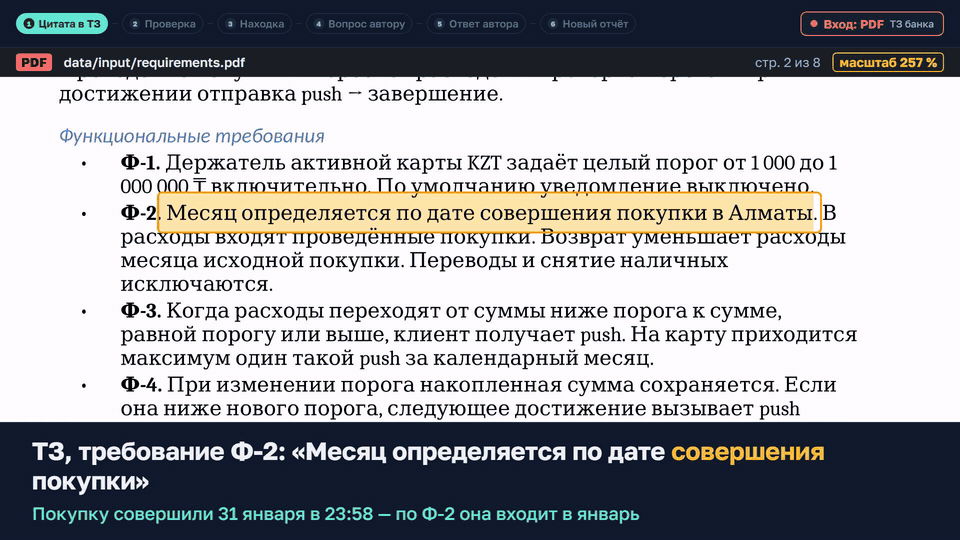
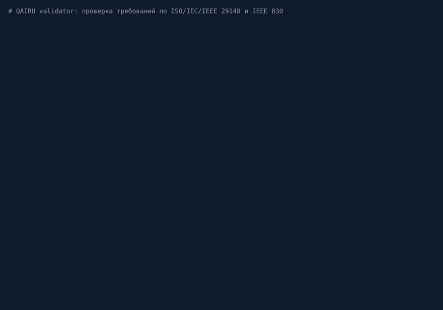

# Демо агента

## Видео на сдачу

[`demo.mp4`](demo.mp4): 2 мин 36 с, 1920×1080, на русском, титры вместо голоса, фоновый звук. Короткая версия для README: [`demo.gif`](demo.gif) (27 с).



Видео рассказывает одну историю. Покупку совершили 31 января в 23:58, а провели 1 февраля в 00:03. По требованию Ф-2 она входит в январь, по критерию приёмки в февраль. Дальше видно, как агент это находит, о чём спрашивает автора и что меняется после ответа.

| Примерно с | Что на экране |
|---|---|
| 0:00 | Титул: QAIRU, кейс, команда |
| 0:05 | Завязка: покупка 31 января в 23:58, проведена 1 февраля в 00:03 |
| 0:10 | Две цитаты в `data/input/requirements.pdf`: Ф-2 и критерий приёмки |
| 0:25 | Одна команда на PDF в replay: 58 требований, 46 нарушений, 6 критичных, 14 вопросов, код 0 |
| 0:40 | Первая страница [`reports/v1.0/report.pdf`](../../reports/v1.0/report.pdf): светофор, «Что исправить первым», вопрос Q-01 |
| 0:55 | Карточка F-02: обе цитаты «сверено: точно», пример-свидетель, тест нельзя написать без решения автора |
| 1:15 | Переход на Markdown-версию того же ТЗ: таблица соответствия номеров (F-02 = F-01, Q-01 = Q-03), у прогона свои цифры 43 / 4 / 15 |
| 1:40 | Вопрос Q-03 с вариантами ответа и ответ автора `answer: A` в [`examples/answers.yaml`](../../examples/answers.yaml) (ответы придуманы для демо) |
| 1:55 | Повторная проверка с `--answers`: 38 / 3 / 3, ответ закрыл F-01, агент предлагает правку критерия приёмки |
| 2:25 | Итог: ссылка на репозиторий и главные цифры из README |

**Модель в видео не вызывается.** Все три команды идут через `--backend replay` по записям живых прогонов: PDF по [`reports/v1.0/run`](../../reports/v1.0/run), Markdown по [`tests/fixtures/e2e/md/run`](../../tests/fixtures/e2e/md/run). Текст терминала, страницы отчёта и строки файлов на экране взяты из настоящего вывода этих команд, ничего не перепечатано руками. Видео смонтировано в Remotion на компьютере участника под Windows, поэтому в выводе терминала пути с `\`. Проект монтажа в репозиторий не входит.

Повторить те же три команды у себя:

```bash
uv run validator data/input/requirements.pdf out/pdf/report.pdf --backend replay --replay reports/v1.0/run
uv run validator data/input/requirements.md out/md/report.md --backend replay --replay tests/fixtures/e2e/md/run
uv run validator data/input/requirements.md out/answers/report.md --backend replay --replay tests/fixtures/e2e/md/run \
  --answers examples/answers.yaml
```

Битого файла в этом видео нет: он есть в записи терминала ниже (PDF под паролем, код 4, `IN-020`) и в витрине [`reports/robustness/`](../../reports/robustness/README.md), 24 сценария.

## Запись терминала

Запись четырёх шагов: проверка `requirements.pdf` одной командой, первая страница отчёта, битый файл и вопросы автору с повторной проверкой по ответам. Сценарий показа с текстом для голоса: [`docs/demo.md`](../demo.md).



**Модель здесь тоже не вызывается.** Проверка документов идёт через `--backend replay` по записям живых прогонов ([`reports/v0.9-rc2/run`](../../reports/v0.9-rc2/run) для PDF, та же запись, что в [`reports/v1.0/run`](../../reports/v1.0/run); [`tests/fixtures/e2e/md/run`](../../tests/fixtures/e2e/md/run) для Markdown), а битый файл отсекается до любого вызова модели. Скрипт к тому же убирает `claude` из `PATH` и ключи API из окружения и отказывается работать, если `claude` всё ещё найден.

| Файл | Что это |
|---|---|
| [`demo.sh`](demo.sh) | Скрипт демо: «набирает» команды и выполняет их. Отчёты кладёт в `out/demo/` (папка в `.gitignore`) |
| [`demo.cast`](demo.cast) | Запись терминала asciinema 2.4 (110×34, 93 с). Смотреть: `asciinema play docs/demo/demo.cast` |
| [`terminal.mp4`](terminal.mp4) | Та же запись видео |
| [`terminal.gif`](terminal.gif) | Та же запись в GIF |
| [`render.cjs`](render.cjs) | Рендер `demo.cast` в кадры через xterm.js и Playwright, кадры склеивает ffmpeg |

### Посмотреть без записи

```bash
bash docs/demo/demo.sh             # с паузами, как на записи, около 1,5 минуты
DEMO_FAST=1 bash docs/demo/demo.sh # без пауз, секунды
```

### Перезаписать запись терминала

Нужны `uv`, Node 18+ с Playwright и Chromium, ffmpeg. agg для asciinema из PyPI не ставится, поэтому кадры рисует `render.cjs`.

```bash
# 1. Запись терминала
uv tool run --from asciinema==2.4.0 asciinema rec --overwrite --cols 110 --rows 34 \
  -t "QAIRU validator: демо (replay)" -c "bash docs/demo/demo.sh" docs/demo/demo.cast

# 2. Кадры (xterm.js во временной папке)
npm install --prefix /tmp/demo-render @xterm/xterm@5.5.0
node docs/demo/render.cjs docs/demo/demo.cast /tmp/demo-frames /tmp/demo-render/node_modules/@xterm/xterm

# 3. MP4 и GIF
cd /tmp/demo-frames
ffmpeg -y -f concat -safe 0 -i frames.txt -vf "fps=12,format=yuv420p,scale=trunc(iw/2)*2:trunc(ih/2)*2" \
  -c:v libx264 -crf 20 -movflags +faststart "$OLDPWD/docs/demo/terminal.mp4"
ffmpeg -y -f concat -safe 0 -i frames.txt -vf "fps=8,scale=880:-1:flags=lanczos,split[a][b];[a]palettegen=max_colors=64:stats_mode=diff[p];[b][p]paletteuse=dither=none:diff_mode=rectangle" \
  "$OLDPWD/docs/demo/terminal.gif"
```

Если релиз v1.0 положит новую запись прогона, поменяйте в `demo.sh` папку `--replay` в шаге 1 и цифры в [`docs/demo.md`](../demo.md).
