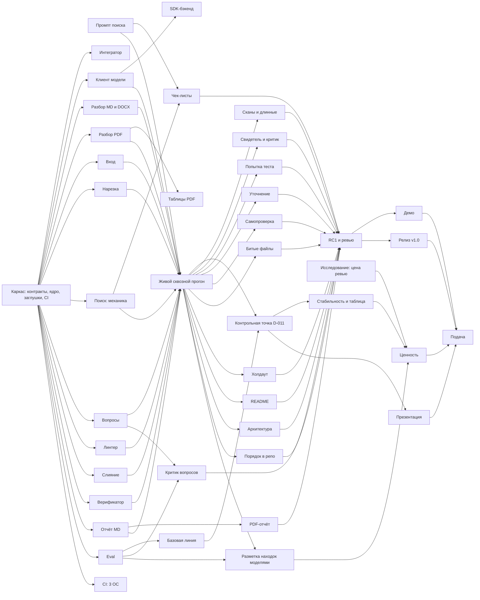

# План до сдачи 27.11 и финала 4.12

> Составлен 25.11.2026 вечером по итоговой идее [`docs/ideas/final-idea.md`](ideas/final-idea.md) (D-009) и выбору моделей D-010 ([`docs/decisions.md`](decisions.md)). Перед публикацией план проверили два независимых критика (взгляд жюри и проверка выполнимости), их правки внесены. Задачи заведены как issues, общий список в эпике #13. Всё время в плане по Астане (UTC+5).

## Коротко

- **Цель не «успеть», а сдать отполированного агента.** Лимитов Claude у команды много, поэтому план закладывает время на ревью каждого PR, независимых критиков, CI на трёх ОС, eval на эталоне и на чужих документах, независимую разметку находок двумя моделями, проверку в чистом контейнере и аккуратные README, схему, демо и презентацию.
- **Главная номинация: Best Architecture** (D-009). Принцип «модель предлагает, код проверяет» должен быть виден в коде, тестах, схеме и цифрах.
- **Конвейер работает с первого PR.** Каркас сразу даёт сквозной прогон на заглушках: одна команда на MD, PDF и DOCX пишет отчёт со всеми разделами ТЗ п. 6. Каждый следующий PR заменяет одну заглушку настоящим модулем и держит этот прогон зелёным. Так к утру не нужна «большая сборка», а `main` всегда рабочий.
- **Код пишут потоки Claude параллельно**, каждый по своему issue. Ночью PR вливает один поток-интегратор в порядке зависимостей. Люди принимают решения, делают то, что может только человек (демо с голосом, студбилеты, подача) и по желанию читают отчёт глазами жюри. Ручных замеров нет (решение Нурдаулета 25.11): разметку находок делают две модели вслепую, ценность считаем по опубликованным оценкам ревью.
- **Правило решения про три прохода и протокол eval записаны ниже до первых прогонов**, чтобы цифры нельзя было подогнать задним числом.

## Вехи

| Когда | Веха | Как проверяем |
|---|---|---|
| 25.11, ~22:30 | Старт каркаса #15 и промпта поиска #14 | Потоки запущены |
| 26.11, ~01:30 | Каркас в `main`: контракты, общее ядро, конвейер на заглушках, CI | `uv run validator data/input/requirements.md out/report.md --backend fake` пишет отчёт со всеми разделами, smoke-тест на трёх форматах зелёный в CI |
| 26.11, 07:30 | Модули P0 влиты, заглушек в конвейере не осталось | Интегратор: состояние в #16, smoke на `main` зелёный |
| 26.11, 10:00 | **Go/no-go:** живой прогон на трёх форматах | Если не зелёный, минимум собираем с одним проходом и урезанной контрольной точкой |
| **26.11, 14:00** | **Минимум:** одна команда на PDF, MD и DOCX даёт отчёт со всеми разделами ТЗ п. 6; eval против базовой линии; решение D-011 по правилу ниже | #36, #37 |
| 26.11, 24:00 | Отчёт v0.8: доказательства, вопросы с критиком, PDF-отчёт, битые файлы, длинные документы; первая разметка находок моделями (#49) | Полный отчёт v0.8 прочитал `idea-critic` |
| 27.11, 09:00 | Кандидат `v0.9-rc1`: отчёт на сдачу из `requirements.pdf` уже в репозитории (страховка) | #54 |
| 27.11, 13:00 | Демо записано на RC1 | #55 |
| **27.11, 16:00** | **Feature freeze:** дальше только исправления | Все P0 и P1 закрыты или осознанно перенесены |
| 27.11, 19:00 | Релиз `v1.0`: финальный отчёт и лог прогона в `reports/`, replay в CI | #56 |
| **27.11, 22:00** | **Подано:** демо, публичный репозиторий, презентация, студбилеты всех участников. До 23:59 запас | #57 |
| 28.11–3.12 | Доработка к финалу этого же агента | P3 |
| 4.12 | Финал в MNU: показ, питч, защита | #61 |

## Расписание по окнам

| Окно (Астана) | Потоки Claude (параллельно) | Люди | Итог окна |
|---|---|---|---|
| 25.11, 21:45–22:30 | Этот поток: план и первые issues | Нурдаулет: запускать ли основу сейчас и как вливать PR ночью | Решение |
| 25.11, 22:30 – 26.11, 01:30 | #15 (отдельный поток). Параллельно #14: ему каркас не нужен. Поток плана дозаводит остальные issues и всю ночь работает интегратором #16 | roma2246: исследование стоимости ручного ревью (для #52). helknow: подготовка чужих документов (#48) | Каркас в `main` |
| 26.11, 01:30–04:30 | **Волна 1**, по длине пути: #18, #19, #20, #21, #22, #23, #24, #25, #26. Интегратор вливает по готовности | Спят | Половина заглушек заменена |
| 26.11, 04:30–07:30 | **Волна 2** на освободившихся местах: #27, #28, #29, #31, #30 | Спят | Модули P0 в `main` |
| 26.11, 07:30–10:30 | #36: живые прогоны на трёх форматах, коды возврата, снапшот replay в CI. 10:00 go/no-go | Нурдаулет: сводка интегратора к 12:00. helknow по желанию: тесты на своей ОС | Живой сквозной прогон |
| 26.11, 10:30–14:00 | #37: прогоны по протоколу, решение D-011 по правилу. Параллельно #32, #33, #34, #35 | Нурдаулет: подтверждает D-011 | **Веха 14:00** |
| 26.11, 14:00–17:00 | #38, #39, #41, #42, #44, #43, #40, #45 | helknow: готовит чужие документы для #48 | Слой доказательств |
| 26.11, 17:00–20:00 | Добиваем P1, #46, #47 (первая версия) | Нурдаулет и Claude: раскадровка слайдов #53 | Всё P1 в `main` |
| 26.11, 20:00–24:00 | Отчёт v0.8 (профиль по D-011, вход `requirements.pdf`), #48, #51 (первый замер), `idea-critic` по отчёту и README, #49 раунд 1 | Нурдаулет по желанию читает отчёт; #49, раунд 1 (разметка моделями) идёт в колонке Claude | Отчёт v0.8 и список правок. Это же запас, если минимум опоздал |
| 26.11, 24:00 – 27.11, 07:00 | Правки по разметке и критике (`fix/…`, правка промпта только с цифрой eval), #50, черновик слайдов, сценарий демо | Спят | Всё готово к кандидату |
| 27.11, 07:00–09:00 | #54: прогон профилем `submit` из `requirements.pdf`, таблица согласия MD, PDF и DOCX, тег `v0.9-rc1` | — | RC1 в репозитории |
| 27.11, 09:00–13:00 | Ревью RC1: пара по скиллу `santa-method` с одной рубрикой и `idea-critic`; проверка в чистом контейнере по README, #49 раунд 2 | По желанию: helknow ревьюит отчёт в ChatGPT, roma2246 читает как лид QA. Нурдаулет: #55 на RC1 | Список правок, демо записано |
| 27.11, 13:00–16:00 | Правки по ревью, финальные цифры #51, #52, #53 v1 к 15:00 | Нурдаулет: слайды и текст питча | **16:00 freeze** |
| 27.11, 16:00–19:00 | #56: тег `v1.0`, финальный прогон, replay в CI | Нурдаулет: переписать терминальную запись, если вывод изменился | Отчёт `v1.0` в репозитории |
| 27.11, 19:00–22:00 | Финальная вычитка, проверка секретов во всей истории | #57: репозиторий публичный, студбилеты, форма | **22:00 подано** |
| 28.11–3.12 | #58, #59, #60 | #61: питч, репетиции | Финал 4.12 |

Одновременно не больше 10 потоков ночью и 8 днём: так конфликты в общих файлах остаются управляемыми, а лимиты подписки не кончаются в важный момент. Если упираемся в лимиты, первыми останавливаем P2.

## Граф зависимостей

Каркас даёт фикстуры и фейковый клиент модели, поэтому модули волны 1 зависят только от него, а не друг от друга.



## Как работаем (обязательно для каждой задачи)

1. **Одна задача = один issue = одна ветка = один PR.** Ветки `feat/…`, `fix/…`, `eval/…`, `docs/…` от свежего `main`. В PR по шаблону: что сделано, как проверено, `Closes #N`. Описание PR и документация по-русски, код и имена по-английски.
2. **Сессия Claude Code:** Opus 5.5, effort `xhigh` (решение Нурдаулета). Fable в коде агента не используем (D-010).
3. **Гейты качества перед PR** (без них PR не вливается):
   - `uv run ruff check`, `uv run ruff format --check`, `uv run mypy src` и `uv run pytest` чистые. Smoke-тест конвейера на трёх форматах зелёный (`tests/test_smoke.py`, бэкенд `fake`).
   - Критичные пути покрыты тестами (`.claude/rules/python.md`): битые и пустые файлы, сверка цитат, разбор ответа модели, свой модуль на фикстурах. Процент покрытия не гейт.
   - Автор прогоняет `/code-review high` и исправляет важное. Для P0 второе мнение даёт интегратор или новая сессия без контекста автора. Автор отвечает на каждое замечание исправлением или причиной.
   - `tests/test_prompt_leak.py` зелёный: в промптах, чек-листах и правилах линтера нет кусков проверяемого документа (CLAUDE.md, правила 2 и 3).
   - Правка промпта: до появления eval (#24) один живой вызов, ответ проходит схему и записан как фикстура; после появления eval прогон и цифра в описании PR (CLAUDE.md, правило 5).
   - `git diff --staged` без ключей и `.env`.
4. **Как вливаем.** PR вливает интегратор (#16), авторы свои PR не вливают: так нет гонок и красного `main`. Порядок вливания по графу зависимостей, после каждого вливания smoke на `main` (бэкенд `fake`); живой smoke только после вливания модулей, которые вызывают модель, чтобы не тратить лимит. Интегратор это поток плана (решение Нурдаулета 25.11): он вливает PR после своего ревью, откатывает неправильное и к 12:00 26.11 пишет Нурдаулету сводку: что влито, что откатили, что ждёт людей, цифры контрольной точки.
5. **Контракты.** `src/validator/models.py` общий словарь для всех модулей, его держит интегратор. Поля только добавляем. Переименование или удаление поля: отдельный маленький PR с пометкой «Меняет контракт» в заголовке, вливаем раньше зависимых. Схемы ответов модели живут в модуле, который делает вызов, а не в `models.py`.
6. **Общие файлы** (`pyproject.toml`, `uv.lock`, `pipeline.py`, `cli.py`, `config.py`, `models.py`, `tests/conftest.py`): каркас заранее кладёт все зависимости и подключает все шаги, поэтому задачам почти не нужно их трогать. Если нужно, правим минимально, перед PR `git fetch origin main && git rebase origin/main`, тесты после rebase.
7. **Эталон не утекает в агента** (CLAUDE.md, правила 2 и 3). `docs/gold/` и `experiments/18-segmentation/gold_segmentation.yaml` читают только задачи eval. В промптах, чек-листах и правилах линтера нет слов из нашего документа. Примеры в промптах только из другого домена.
8. **Разметка вслепую.** Ручных замеров нет. Разметчики находок (#49, две модели) не видят `docs/gold`, вердикты судьи и разметку друг друга; в пачки подмешаны контрольные ложные находки, чтобы проверить самих разметчиков.
9. **Живые вызовы и лимиты.** Ответы модели кешируются на диск, отладка идёт на кеше и replay. Ночью задача делает не больше 3 живых вызовов без `xhigh`; у #14, #31, #24 и #37 свой бюджет в issue. `xhigh` на проходах только для RC1 и финального отчёта. Прогон дольше 10 минут запускаем, только когда он нужен для решения.
10. **Документация в том же PR.** Если меняется поведение, CLI или формат отчёта, правим README, `docs/architecture.md` и примеры сразу.

## Протокол eval и правило D-011 (зафиксировано до прогонов)

**Протокол сравнения.** Агент и базовая линия судятся одинаково, иначе таблица «один промпт против агента» ничего не доказывает.

- Базовая линия: промпт из исследования 11 дословно, через наш клиент модели, Opus 5.5 `medium`, вход `requirements.md`. Сырые ответы исследования 11 в git не лежат, поэтому прогоняем заново, 3 раза.
- Доля сверенных цитат у базовой линии считается по её сырому тексту тем же верификатором, что у агента. Перенос в JSON через Haiku к базовой линии не применяем.
- Судья один для всех: промпт, схема, модель и effort из `experiments/21-model-effort/run_matrix.py` (Opus 5.5 `high`), вслепую (судья не знает, чей список), находки подаются одинаковым нумерованным списком. Агента судим по находкам после верификатора.
- Метрики: recall по всем 45 дефектам и по критичным, строгий recall, доля сверенных цитат, стабильность (Жаккар множеств находок по `stable_key` между прогонами), время, цена по тарифу API. Precision считаем только по независимой разметке двумя моделями вслепую (#49).
- Холдаут (чужие документы) гоняем только на вехах, чтобы не подгонять под него промпты.

**Прогоны на контрольной точке** (каждый по 3 раза на `requirements.md`, кроме B′):

| Конфигурация | Что это |
|---|---|
| A | Базовая линия, один промпт |
| B | Агент, 1 проход `medium` |
| B′ | Агент, 1 проход `medium` на сыром тексте без ID блоков (2 прогона): D-010 мерили на сыром MD, проверяем, что разметка блоков не мешает |
| C | Агент, 3 прохода `medium` |

**Правило D-011.**

1. **Три прохода по умолчанию** (профили `standard` и `submit`), если доля сверенных цитат у C не ниже, чем у B, и выполнено хотя бы одно: Жаккар у C выше на 0,10 и больше; recall критичных выше на 10 п. п. и больше; recall всего выше на 5 п. п. и больше. Иначе по умолчанию один проход, а `--passes 3` остаётся опцией.
2. **Разметка блоков.** Если recall у B ниже, чем у B′, больше чем на 5 п. п., поиск получает текст без ID блоков, а привязку к блокам делает код по цитате.
3. **Агент против базовой линии.** Если recall выбранной конфигурации ниже, чем у A, больше чем на 5 п. п., первая задача после 14:00 это доработка промпта поиска (#14 открываем снова), до слоя доказательств.
4. Пороги не меняем после того, как увидели цифры. Если всё же меняем, пишем в D-011, что правило изменено и почему.

## Архитектура и контракты

Структура пакета (создаёт #15, остальные задачи заполняют свои модули):

```text
src/validator/
  cli.py            # typer: validator ВХОД ВЫХОД [опции]
  config.py         # .env, профили прогона, таблица моделей по шагам (D-010)
  models.py         # pydantic-контракты и перечисления (общий словарь)
  errors.py         # иерархия исключений и код возврата из диагностики
  text.py           # normalize, locate_quote (из experiments/03-proto/quote_check.py)
  pipeline.py       # оркестрация шагов 0–9, политика отказа на каждом шаге
  passport.py       # версия агента (git describe, признак dirty, AGENT_VERSION), хеши, окружение
  ingest/           # guard.py (шаг 0), md.py, docx.py, pdf.py, blocks.py (build_blocks, render_for_model)
  segment.py        # шаг 2: нарезка
  lint/             # шаг 3: правила без модели
  search.py         # шаг 4: N проходов текстом + перенос в JSON
  merge.py          # шаг 5: слияние, «найдено в N из K»
  evidence.py       # шаг 6: пример-свидетель, критик, попытка теста
  verify.py         # шаг 7: цитаты, привязка к R-NN, важность, счётчики
  questions.py      # шаг 8: вопросы автору
  clarify.py        # answers.yaml, --answers, --ask
  report/           # build.py, render_md.py + шаблоны, render_pdf.py + report.typ + fonts/, selfcheck.py
  llm/              # base.py (протокол), fake.py, claude_cli.py, anthropic_api.py, replay.py, cache.py, calllog.py, pricing.py
  prompts/          # тексты промптов (*.md), хеш папки идёт в паспорт
  checklists/       # общие доменные чек-листы (*.yaml)
evals/              # gold.yaml, eval.py, match.py, judge.py, baseline.py, mutate.py, holdout/, results/
tests/              # fixtures/ (документы, битые файлы, записанные ответы модели), test_*.py, test_smoke.py, test_prompt_leak.py
reports/            # отчёт на сдачу (.md, .pdf, .json), run/ (лог вызовов для replay), robustness/
```

**Конвейер и модели** (D-009, D-010):

| Шаг | Модуль | Модель и effort | Формат ответа | Вызовов | Если шаг упал |
|---|---|---|---|---|---|
| 0. Защищённый вход | `ingest/guard.py` | без модели | — | 0 | Отчёт-диагностика, код 4 |
| 1. Разбор в блоки с якорями | `ingest/*.py` | без модели | — | 0 | Часть текста: диагностика, код 3 |
| 2. Нарезка | `segment.py` | Sonnet 5.5 `medium` | JSON по схеме: модель указывает ID блоков, код цитирует | 1 | Каждый блок с признаками требования становится требованием, диагностика |
| 3. Линтер | `lint/` | без модели | — | 0 | Шаг пропущен, диагностика |
| 4. Поиск, N проходов | `search.py` | Opus 5.5 `medium` (профиль `submit`: `xhigh`) | свободный текст, без схемы | N | Упал один проход: «K−1 из K» с пометкой. Упали все: отчёт по линтеру, код 5 |
| 4б. Перенос прохода в JSON | `search.py` | Haiku 5.5 `medium` | JSON по схеме, цитата дословно, ID блоков | N | Повтор, затем проход считается упавшим |
| 5. Слияние | `merge.py` | без модели | — | 0 | — |
| 6. Свидетель, критик, попытка теста | `evidence.py` | Opus 5.5 `high` (тест: Sonnet 5.5 `high`) | текст с рассуждением, затем JSON | 2–3 | Находки идут без свидетеля с пометкой |
| 7. Верификатор | `verify.py` | без модели | — | 0 | — |
| 8. Вопросы автору | `questions.py` | Opus 5.5 `high` | текст, затем JSON | 1 (+1 критик, P1) | Раздел с диагностикой |
| 9. Отчёт | `report/` | без модели | JSON → Markdown и PDF | 0 | Markdown пишется всегда |

Модели передаём полными именами (`claude-opus-5-5`, `claude-sonnet-5-5`, `claude-haiku-5-5`), effort всегда явно, `CLAUDE_EFFORT` убираем из окружения `claude -p`.

**Сигнатуры, которые фиксирует каркас** (точные поля в `models.py`):

```python
# общее ядро
normalize(text) -> tuple[str, list[int]]             # нормализованный текст и карта смещений в исходный
locate_quote(doc, quote, within=()) -> Quote         # точно, нечётко (rapidfuzz) или не найдено
build_blocks(lines, source) -> list[Block]           # ID блоков B001, предложения B001.2 (razdel), стек разделов
render_for_model(doc) -> str                         # документ с ID блоков для модели (исследование 18, п. 3.2)
class LLMClient(Protocol):
    def call(self, req: LLMRequest) -> LLMResponse   # FakeLLM отвечает из фикстур
# шаги конвейера: каждая задача заменяет свою заглушку
guard(path) -> GuardResult                           # вид файла, диагностика, фатально ли
parse(path, kind) -> ParsedDocument
segment(doc, llm, cfg) -> Segmentation               # требования и исключённые блоки с причиной
lint(doc, seg) -> list[CandidateFinding]
search(doc, llm, cfg) -> list[PassResult]            # сырой текст прохода, кандидаты, ID вызовов
merge(passes, lint_hits, doc) -> list[MergedFinding]
evidence(found, doc, llm, cfg) -> list[MergedFinding]  # до P1 возвращает вход без изменений
verify(found, doc, seg) -> Verification              # находки F-NN, отброшенные с причиной, сводка, светофор
ask(ver, doc, seg, llm, cfg) -> list[Question]
build_report(ctx) -> Report; render_md(report) -> str
run(cfg: RunConfig) -> RunOutcome                    # не бросает исключений; код возврата из диагностики
```

**Как данные идут по конвейеру:**

- `ParsedDocument.text` это канонический извлечённый текст. Смещения якорей указывают в него, цитаты сверяются с ним, у ячеек таблиц свои смещения.
- Поиск видит `render_for_model(doc)` и не знает про `R-NN`, поэтому идёт параллельно с нарезкой. Перенос в JSON возвращает ID блоков, дословную цитату, свойство стандарта, тип дефекта, `blocks_testing` (мешает ли написать тест) и подсказку важности.
- Находка проходит три состояния: `CandidateFinding` (один проход или правило линтера) → `MergedFinding` (слияние, «найдено в N из K», источники) → `Finding` (после верификатора; `F-NN` присваивается после сортировки).
- Верификатор привязывает находку к `R-NN` по пересечению якорей. Пропуск на уровне набора без цитаты привязывается к заголовку раздела.
- Важность считает код по таблице «тип дефекта × мешает ли тесту» в `verify.py`. Важность от модели только подсказка.
- Перечисления в `models.py`: `DefectType`, `Property` (со ссылкой на пункт 29148 п. 5.2.5 или 5.2.6 и IEEE 830 п. 4.3.x), `Verdict` (нарушение или «неясно»), `Severity`, `ExitCode`, `DiagLevel`.
- Остальные типы: `Diagnostic` (код `IN-xxx`, `LLM-xxx`, `INT-xxx`, уровень, что увидели, что сделал агент, что сделать человеку, где), `Anchor` и `Block`, `ParsedDocument`, `Requirement` (`R-NN`, ID в документе, тип, формулировка, цитата от кода, якорь, `stable_key`), `Quote`, `Witness`, `TestDraft`, `Question` (по исследованию 17, п. 3.1), `LLMRequest`, `LLMResponse`, `CallRecord`, `RunConfig`, `RunContext`, `Passport`, `RunMetrics`, `Report`. `report.json` это сериализация `Report`, из него рендерятся Markdown и PDF.
- Исключения: `ValidatorError` и наследники `InputError`, `LLMError`, `ConfigError`, `InternalError`. Функция `exit_code(diagnostics)` выводит код возврата из диагностики.

**CLI и выходы:**

```text
uv run validator ВХОД ВЫХОД [--profile quick|standard|submit] [--passes N]
                 [--backend auto|cli|api|replay|fake] [--replay ПАПКА] [--cache use|refresh|off]
                 [--answers answers.yaml] [--ask] [--max-budget-usd X]
```

- `ВЫХОД` с расширением `.md` или `.pdf`. Для `out/report.pdf` пишутся и PDF, и `out/report.md` (PDF собирает Typst из того же `Report`, шрифты Liberation с кириллицей лежат в `src/validator/report/fonts/`, лицензия OFL). Если Typst упал, Markdown всё равно записан, в отчёте диагностика `INT-002`, код возврата не меняется. После сборки отчёт проверяет сам себя (#43, `report/selfcheck.py`): 6 разделов ТЗ п. 6, якорь и сверенная цитата у каждой находки, счётчики сводки против строк таблиц, каждый `R-NN` в проверке требований, матрица покрытия против находок. Строка результата идёт в паспорт, подробности в разделе «Самопроверка отчёта». Нарушена целостность (находка без якоря, счётчик не сошёлся): диагностика `INT-003`, код 1; не хватает раздела: `INT-004`, код не меняется. Отчёт при этом не правится и пишется как есть. Для `out/report.md` рядом пишутся `out/report.json`, `out/questions.yaml`, `out/report.log` и папка `out/run/` с `calls.jsonl` и ответами модели для replay. Кеш ответов лежит отдельно, в `.cache/validator/` (в `.gitignore`). Ключ кеша: хеш модели, effort, системного промпта, промпта и схемы. Replay ищет ответ по ключу, а если промпт поменялся, по паре «шаг, номер вызова».
- Профили: `quick` (1 проход `medium`), `standard` (3 прохода `medium`), `submit` (3 прохода `xhigh`). Число проходов по умолчанию задаёт D-011.
- Бэкенд `auto`: есть `claude` с входом, идём через подписку (она бесплатна, а ключ в `.env` может быть без средств, D-009); нет подписки, но есть `ANTHROPIC_API_KEY`, идём через SDK; нет ни того ни другого, пересобираем из лога или пишем отчёт-диагностику `LLM-001`. Только API: `--backend api` (#32). Бэкенд `fake` отвечает из фикстур, на нём работают smoke-тест и CI.
- Коды возврата (исследование 04, раздел 4): 0 вход прочитан и проверка сделана (найденные дефекты код не меняют); 1 внутренняя ошибка; 2 ошибка аргументов; 3 вход прочитан частично; 4 вход не обработать; 5 сбой модели или конфигурации. Отчёт пишется во всех случаях, когда доступен путь отчёта.
- Отчёт на сдачу делаем с `requirements.pdf` (ТЗ п. 3: PDF обязателен), рядом кладём таблицу согласия находок на MD, PDF и DOCX.

## Качество: что и как меряем

- **В заголовок README и презентации** (D-009): precision по независимой разметке двумя моделями вслепую (#49, честно с пометкой «не люди»), доля сверенных цитат (код отбрасывает несверенное; показываем, сколько отброшено до фильтра), стабильность между прогонами (Жаккар, цель от 0,7), число и качество вопросов автору, время и цена прогона. Recall по эталону только с оговоркой, что эталон тоже составлял Claude.
- **Наборы:** основной документ в MD, PDF и DOCX (eval по эталону); чужие документы (ТЗ кейса `docs/case/task.md`, c4 под MIT); мутации, если останется время (P2); битые файлы; длинный документ.
- **Когда гоняем:** после правки промпта один живой прогон и сравнение с прошлой цифрой; на вехах (26.11 14:00 и 22:00, 27.11 RC1) по 3 прогона; холдаут только на вехах.
- **Судья:** по протоколу выше, кеш вердиктов, ручные поправки важнее судьи. Выборку из 20 сопоставлений перепроверяет вторая модель (Fable 5.2): так видно, не подыгрывает ли судья своей модели.
- **Вопросы автору:** метрики из исследования 17, п. 4.3; сравнение с вопросами, которые участники задали на kick-off (#48).
- **Ценность:** время ручного ревью по опубликованным скоростям инспекции (исследование 22, roma2246) против времени агента плюс оценки времени на проверку отчёта агента; цена в тенге; всё, что не замер, помечено «оценка» (#52).

## Ревью и полировка

- **Каждый PR:** гейты из раздела «Как работаем».
- **26.11, вечер:** `idea-critic` читает отчёт v0.8 и README глазами жюри; первая разметка находок моделями (#49). Исправления заводим как `fix/…`.
- **27.11, утро (RC1):** пара ревьюеров по скиллу `santa-method` с одной рубрикой и `idea-critic`; один ревьюер пары на Fable 5.2 (другая модель); второй раунд разметки моделями; проверка по README в чистом облачном контейнере. Люди по желанию: helknow в ChatGPT, roma2246 как лид QA.
- **После 16:00 27.11:** только исправления ошибок, без новых функций и без правок промптов, которые не прошли eval.

## Если не успеваем: что режем

По порядку, сверху вниз:

1. P3 (и так после сдачи).
2. P2: мутации, `--ask` в терминале.
3. Таблицы PDF по ячейкам (остаётся текст с якорем страницы) и SDK-бэкенд вживую (остаётся проверка на записанных ответах).
4. Пример-свидетель: сценарии уходят в отчёт как «для ручной проверки» без сверки кодом.
5. Попытка теста.
6. Три прохода: остаётся один (если контрольная точка не показала прирост, это решится раньше).

Не режем никогда: минимум, вопросы автору, верификатор цитат, диагностику битых файлов, длинные документы без падения, README, презентацию, демо, подачу.

## Ресурсы команды

| Кто | Подписки | Что лучше всего делает в плане |
|---|---|---|
| Потоки Claude в проекте | лимиты проекта | Код по issues, интеграция, ревью PR, eval, документация, черновики презентации |
| Нурдаулет | 2 × Claude Max (+ Fable) | Решения по продукту, вливание днём, чтение отчёта целиком, презентация и питч, демо с голосом, студбилеты, подача, публичный репозиторий. Может взять любой issue в своей сессии Claude Code |
| roma2246 (третий участник) | Claude Max | Исследование стоимости ручного ревью для бизнес-ценности (`docs/research/22-review-cost-benchmarks.md`), дальше свои сессии Claude Code по issues, помощь с презентацией и демо |
| helknow | Claude Pro + ChatGPT | Подготовка чужих документов для #48, по желанию проверка на своей ОС и ревью отчёта в ChatGPT |

## Главные риски плана

| Риск | Что делаем |
|---|---|
| Много параллельных потоков конфликтуют в общих файлах | Каркас кладёт все зависимости и подключает все шаги; контракты держит интегратор; схемы ответов в своих модулях; rebase перед PR; правило «Меняет контракт» |
| Ночью `main` краснеет и никто не замечает | Вливает только интегратор, по порядку, smoke после каждого вливания, живой smoke после модулей с вызовом модели; сводка Нурдаулету к 12:00 |
| Минимум к 14:00 опаздывает | Конвейер рабочий с первого PR; go/no-go в 10:00; окно 20:00–24:00 26.11 служит запасом; режем по лестнице выше |
| Лимиты подписки кончаются в момент финального прогона на `xhigh` | Ночью не больше 3 живых вызовов на задачу; финальный прогон идёт один, остальные потоки в это время не делают живых вызовов; RC1 утром 27.11 как страховка; два аккаунта Max |
| Жюри с ключом API запускает путь через SDK, а он вживую не проверен | SDK-бэкенд проверен тестами на записанных ответах (#32); в README честно три пути запуска и цена прогона. Если Нурдаулет решит положить $5–10 на ключ, один живой прогон через SDK входит в #32 |
| Жюри открывает `docs/gold/` и подозревает подгонку | #46: в README раздел «Как мы не подгоняли»: где эталон, кто его читает, `test_prompt_leak.py`, результаты на чужих документах |
| Документ от жюри длинный, на английском или смешанном языке, или с инъекцией в тексте | #38 и #44: нарезка по разделам, таймауты, проверка на английском документе, текст документа в промпте как данные, тест на инъекцию |
| Скан без текста | Шаг 0 опознаёт, отчёт-диагностика с инструкцией; передача страниц модели в #38, если успеваем |
| Typst и кириллица на Windows | #34: шрифты лежат в репозитории, PDF-отчёт проверяем в CI на трёх ОС; Markdown пишется всегда |
| Цифра ценности выглядит подогнанной | Только опубликованные источники с датой (исследование 22), всё, что не замер, помечено «оценка», строка «в худшем случае» (#52) |
| Precision от моделей того же семейства завышена | Два разных разметчика (Opus 5.5 и Fable 5.2), согласие между ними, доля пойманных контрольных ложных находок; в README честно «разметка моделями» |
| Демо и слайды делает один человек в последний момент | Раскадровка 26.11 вечером, демо пишем на RC1 к 13:00 27.11, слайды v1 к 15:00 |
| Форма демо или презентации не та, что ждут организаторы | Готовим и запись терминала, и видео с голосом; презентацию в формате, который можно выгрузить в PDF и PPTX |

## Задачи

Метки: `P0` без этого не сдаём, `P1` должно быть к сдаче, `P2` полировка, если есть время до freeze, `P3` к финалу 4.12; `task` код, `human` делает человек, `eval` замеры, `docs` документация и подача, `epic` общий список. Оценки в часах работы потока Claude, без ожидания прогонов.

| Issue | Задача | P | Зависит от | Окно | Часы | Кто |
|---|---|---|---|---|---|---|
| #1 | ~~Ручной замер ревью вслепую~~ (закрыт 25.11: ручных замеров не делаем) | — | — | — | — | — |
| #15 | Каркас: контракты, общее ядро, конвейер на заглушках, минимальный CI | P0 | — | 25.11, 22:30 – 26.11, 01:30 | 3 | Claude |
| #14 | Промпт и рубрика поиска дефектов (шаг 4) | P0 | — | 25.11, 22:30 – 26.11, 03:00 | 3 | Claude |
| #16 | Интегратор ночи: вливание по порядку, smoke, сводка | P0 | #15 | 26.11, 01:30–10:00 | — | Claude |
| #18 | Поиск: N проходов, перенос в JSON, таймауты, «K−1 из K» | P0 | #15 | волна 1 | 3 | Claude |
| #19 | Нарезка: модель указывает блоки, код цитирует (шаг 2) | P0 | #15 | волна 1 | 3 | Claude |
| #20 | Вопросы автору: кандидаты кодом и редактор (шаг 8) | P0 | #15 | волна 1 | 3 | Claude |
| #21 | Клиент модели: подписка, кеш, лог вызовов, replay, ошибки | P0 | #15 | волна 1 | 3 | Claude |
| #22 | Верификатор: привязка к R-NN, важность, счётчики, светофор (шаг 7) | P0 | #15 | волна 1 | 3 | Claude |
| #23 | Отчёт в Markdown: разделы ТЗ п. 6, первая страница, статус каждого требования (шаг 9) | P0 | #15 | волна 1 | 3 | Claude |
| #24 | Eval: эталон в YAML, судья, метрики | P0 | #15 | волна 1 | 3 | Claude |
| #25 | Разбор MD и DOCX в блоки с якорями (шаг 1) | P0 | #15 | волна 1 | 2,5 | Claude |
| #26 | Разбор PDF: текст в порядке чтения, якоря страниц (шаг 1) | P0 | #15 | волна 1 | 2,5 | Claude |
| #27 | Защищённый вход и диагностика входа (шаг 0) | P0 | #15 | волна 2 | 2,5 | Claude |
| #28 | Линтер правил без модели (шаг 3) | P0 | #15 | волна 2 | 2,5 | Claude |
| #29 | Слияние проходов и линтера, «найдено в N из K» (шаг 5) | P0 | #15 | волна 2 | 2 | Claude |
| #31 | Eval: базовая линия «один промпт» по протоколу | P0 | #15, #24 | волна 2 | 1,5 | Claude |
| #30 | CI: Ubuntu, Windows, macOS, mypy, поиск секретов | P1 | #15 | волна 2 | 1,5 | Claude |
| #36 | Живой сквозной прогон на трёх форматах, коды возврата, снапшот replay в CI | P0 | модули P0 | 26.11, 07:30–10:30 | 2 | Claude |
| #37 | Контрольная точка: прогоны по протоколу, решение D-011 | P0 | #36, #31 | 26.11, 10:30–14:00 | 2 | Claude + Нурдаулет |
| #32 | SDK-бэкенд `anthropic` на записанных ответах | P1 | #21 | 26.11, 10:30–14:00 | 2,5 | Claude |
| #33 | Таблицы PDF по ячейкам | P1 | #26 | 26.11, 10:30–14:00 | 2 | Claude |
| #34 | PDF-версия отчёта через Typst | P1 | #23 | 26.11, 10:30–17:00 | 2,5 | Claude |
| #35 | Доменные чек-листы с триггерами без подгонки | P1 | #14, #18, #24 | 26.11, 10:30–17:00 | 2,5 | Claude |
| #38 | Сканы без текста и длинные документы | P0 | #36 | 26.11, 14:00–17:00 | 3 | Claude |
| #39 | Пример-свидетель и критик находок (шаг 6) | P1 | #36 | 26.11, 14:00–17:00 | 3 | Claude |
| #40 | Попытка тест-кейса: какого значения не хватает | P1 | #36 | 26.11, 14:00–20:00 | 2,5 | Claude |
| #41 | Вопросы: критик-самоответ и метрики вопросов | P1 | #20, #24 | 26.11, 14:00–17:00 | 2 | Claude |
| #42 | Цикл уточнения: `answers.yaml`, `--answers`, `--ask` | P1 | #36 | 26.11, 14:00–17:00 | 3 | Claude |
| #43 | Самопроверка отчёта по ТЗ п. 6, матрица покрытия, метрики прогона | P1 | #36 | 26.11, 14:00–17:00 | 2 | Claude |
| #44 | Битые файлы и сбои модели: отчёты в `reports/robustness/`, инъекция, английский документ | P1 | #36 | 26.11, 14:00–17:00 | 2,5 | Claude |
| #45 | Архитектура: схема конвейера, `docs/architecture.md`, ADR | P1 | #36 | 26.11, 14:00–20:00 | 2,5 | Claude |
| #46 | Порядок в репозитории для жюри: навигация, устаревшее, «как не подгоняли», лицензия | P1 | #36 | 26.11, 17:00–20:00 | 2 | Claude |
| #47 | README агента для жюри | P0 | #36 | 26.11, 17:00 – 27.11, 15:00 | 3 | Claude |
| #48 | Чужие документы и сравнение вопросов с kick-off | P1 | #36 | 26.11, 20:00–24:00 | 2,5 | Claude (подготовка: helknow) |
| #49 | Precision: независимая разметка находок двумя моделями вслепую | P0 | #36, #24 | 26.11, 20:00–23:00 и 27.11, 09:00–11:00 | 2 | Claude |
| #51 | Стабильность и таблица «один промпт против агента» | P1 | #37 | 26.11 вечер, 27.11 до 15:00 | 2 | Claude |
| #50 | Мутации документа и recall по операторам | P2 | #36, #24 | ночь 26→27 | 3 | Claude |
| #52 | Бизнес-ценность: опубликованные оценки ревью против замеров агента, цена в тенге | P1 | исследование 22, #49, #51 | 27.11, 12:00–15:00 | 1,5 | Claude |
| #53 | Презентация к сдаче | P0 | #37 | раскадровка 26.11 вечером, v1 27.11 к 15:00 | 3 | Claude + Нурдаулет |
| #54 | Кандидат `v0.9-rc1` из PDF и независимые ревью | P0 | P0 и P1 выше | 27.11, 07:00–13:00 | 2 | Claude + все |
| #55 | Демо: запись терминала для README и видео для формы | P0 | #54 | 27.11, 11:00–13:00 | 2 | Нурдаулет + Claude |
| #56 | Релиз `v1.0`: финальный прогон, отчёт и лог в `reports/`, replay в CI | P0 | #54 | 27.11, 16:00–19:00 | 2 | Claude |
| #57 | Подача: секреты, лицензия, публичный репозиторий, студбилеты, форма | P0 | #56, #53, #55 | 27.11, 19:00–22:00 | 1 | Нурдаулет |
| #58 | Формальная проверка противоречий (JSON-DSL и Z3) | P3 | #56 | 28.11–3.12 | 6 | Claude |
| #59 | Полный режим уточнений и сравнение версий ТЗ | P3 | #42 | 28.11–3.12 | 5 | Claude |
| #60 | Закрытый контур банка: локальная модель, пример для GitLab CI | P3 | #56 | 28.11–3.12 | 5 | Claude |
| #61 | Финал 4.12: питч, живое демо, защита | P3 | #57 | 28.11–4.12 | — | вся команда |

Закрыто при составлении плана: #5 (проверки API с ключом, ключ не пополняем по D-009; SDK-бэкенд проверяем на записанных ответах в #32). #1 (ручной замер) закрыт 25.11 по решению Нурдаулета: ручных замеров не делаем; #49 и #52 переписаны под разметку моделями и опубликованные оценки. Вычеркнуто по итогам критики: заполненный чек-лист ревью из шаблона банка (похоже на подгонку под наш документ) и обязательный пересчёт дат и сумм в примере-свидетеле.
